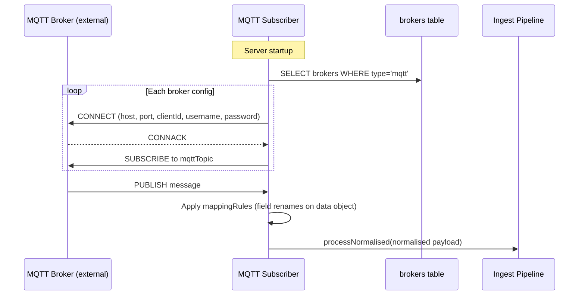
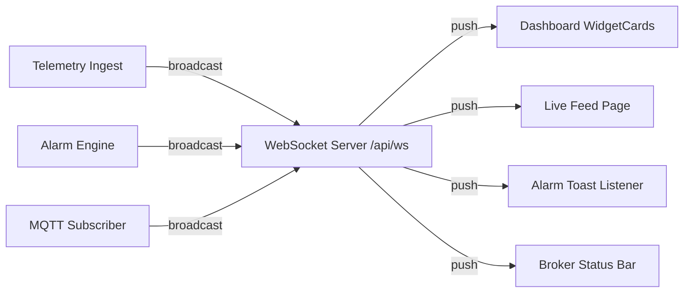

# Integration Architecture

**Confidence: High** — based on implemented broker, ingest, webhook, and WebSocket code.

---

## Overview

WS-Integrated Suite integrates with external systems in three directions:

1. **Inbound** — field devices push telemetry via MQTT or HTTP
2. **Outbound** — alarm events are pushed to configured webhook receivers
3. **Bidirectional** — external tools (Node-RED, ETL) query and interact with the REST API

---

## Internal Integrations

### Ingest → Alarm Engine
The ingest pipeline (`processNormalised`) directly calls `evaluateAlarmRules()` after writing telemetry. This is a synchronous in-process call — alarm evaluation is part of the ingest transaction.

### Ingest → Expression Engine
After updating dynamic attributes, `evaluateRuntimeAttributes()` is called for the affected asset. It reads all numeric attribute values and re-evaluates all `runtime`-type attribute expressions using `expr-eval`.

### Alarm Engine → WebSocket Broadcaster
After evaluating rules, alarm events are broadcast via `broadcast("alarm", {...})`. The WebSocket broadcast iterates all open connections synchronously.

### MQTT Service → Ingest Pipeline
The MQTT subscriber service calls `processNormalised()` directly after receiving and mapping a message. There is no queue between MQTT reception and ingest — each MQTT message is processed synchronously.

---

## External Integrations

### MQTT Broker Integration



**Broker types supported:** `mqtt`, `rest`, `azure`  
**MQTT protocol:** MQTT 5 (via `mqtt` npm package v5)  
**Reconnect:** Automatic via mqtt package built-in reconnect logic

**Mapping Rules:**
```json
[
  { "from": "temp", "to": "temperature" },
  { "from": "rh", "to": "humidity" }
]
```
Applied to the `data` object of the payload before normalisation.

---

### REST Device Integration

Any HTTP client can push telemetry:

```bash
curl -X POST https://your-domain/api/ingest/payload \
  -H "Content-Type: application/json" \
  -H "Authorization: Bearer <clientSecret>" \
  -d '{
    "deviceId": "sensor-001",
    "timestamp": "2025-01-14T10:00:00Z",
    "data": { "temperature": 25.3, "humidity": 62.1 }
  }'
```

Scope required: `ingest:write` (or empty scopes = super-key)

---

### Alarm Webhook Integration

When an alarm rule with `webhookEnabled: true` triggers or clears, the platform sends:

```http
POST https://configured-webhook-url
Content-Type: application/json

{
  "event": "triggered",
  "alarmId": "uuid",
  "ruleName": "High Vibration",
  "metric": "vibration",
  "value": 5.8,
  "threshold": 5.0,
  "operator": "gt",
  "severity": "high",
  "assetId": "uuid",
  "assetName": "Fan Motor A",
  "timestamp": "2025-01-14T10:00:00Z"
}
```

**Delivery characteristics:**
- Timeout: 5 seconds (`AbortSignal.timeout(5000)`)
- Non-blocking: sent via `void fetch(...)` — does not affect ingest response time
- No retry: failed deliveries are silently discarded
- No authentication: no outbound auth headers added

---

### Node-RED Integration

The platform ships a built-in Integration Guide (`/node-red-docs`) with:
- Connection setup instructions
- HTTP Request node configuration
- Authentication configuration
- Example flow templates for common patterns

**Recommended Node-RED usage:**
```
[HTTP Request] → POST /api/ingest/payload → [Response handler]
[Inject/Interval] → GET /api/assets → [Process assets]
[HTTP Request] → GET /api/alarms → [Filter active alarms]
```

---

## Event Flows

### Real-Time Event Bus (WebSocket)



**Event filtering:** Client-side only. The server broadcasts all events to all connected clients; the client filters by `type` and `assetId` as needed.

---

## API Client Scopes

| Scope | Grants Access To |
|-------|----------------|
| `ingest:write` | POST /api/ingest/* |
| `assets:read` | GET /api/assets/* |
| `assets:write` | POST/PUT/DELETE /api/assets/* |
| `alarms:read` | GET /api/alarms/* |
| `alarms:write` | POST /api/alarms/:id/acknowledge |
| `*` or `[]` (empty) | All endpoints (super-key) |

> **Note:** Scope enforcement is only applied when `requiredScope` is passed to `apiKeyAuth()`. Currently only ingest endpoints use scoped auth; all other endpoints are accessible without a token.
