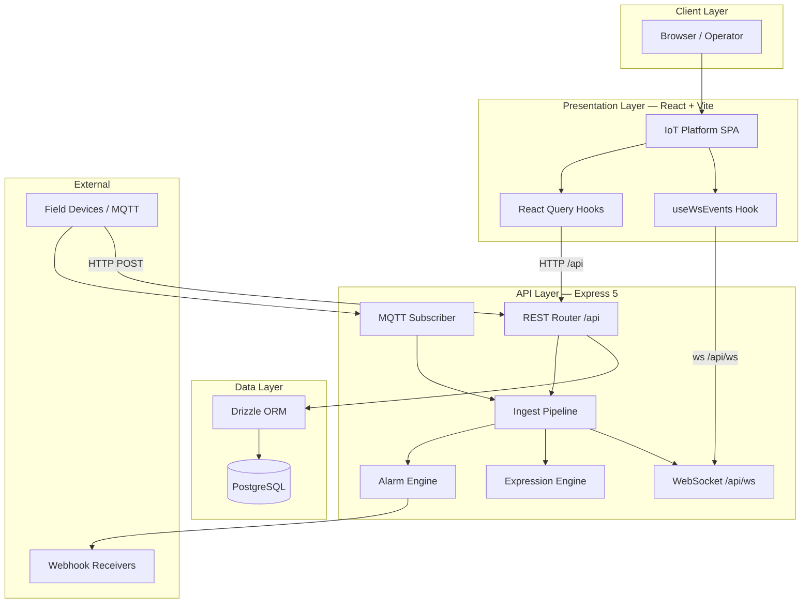

# Solution Architecture

**Confidence: High** — derived from implemented source code.

---

## Executive Summary

WS-Integrated Suite is a three-tier industrial IoT platform composed of a React SPA frontend, an Express 5 REST/WebSocket API backend, and a PostgreSQL relational database. It is packaged as a pnpm monorepo with shared contract-first OpenAPI code generation binding the layers together. The system is designed for single-node deployment on Replit with a path-based reverse proxy providing unified access to both the API and the frontend.

---

## Architecture Principles

| Principle | Applied As |
|-----------|-----------|
| **Contract-first API** | OpenAPI 3.1 spec drives code generation for client hooks and Zod validation schemas |
| **Schema-first database** | Drizzle ORM TypeScript schema is the single source of truth; migrations generated from it |
| **Real-time by default** | WebSocket server co-hosted with REST API; all telemetry ingest broadcasts events immediately |
| **Fail-safe alarm delivery** | Webhook dispatch is non-blocking with 5 s timeout; failures are silent to avoid blocking ingest |
| **Role-based least privilege** | UI enforces permissions per role; API enforces scope per machine client |
| **Documentation as code** | All docs maintained alongside source; governed by `docs/governance.md` |

---

## High-Level Design

---

## System Decomposition

| Component | Technology | Responsibility |
|-----------|-----------|----------------|
| `artifacts/iot-platform` | React 19, Vite, Tailwind, shadcn/ui, Recharts | User interface for all platform domains |
| `artifacts/api-server` | Express 5, Node.js 20, pino | REST API, WebSocket server, ingest pipeline |
| `lib/db` | Drizzle ORM, node-postgres | Schema definitions, migration runner, typed DB client |
| `lib/api-spec` | OpenAPI 3.1, Orval | Contract definition and codegen orchestration |
| `lib/api-client-react` | TanStack Query v5, generated fetch client | Typed React hooks for all API endpoints |
| `lib/api-zod` | Zod v4, drizzle-zod | Request/response validation schemas |
| MQTT Subscriber | mqtt npm package | Manages broker connections, applies mapping rules |
| Alarm Engine | Inline in `ingest.ts` | Evaluates threshold + rate-of-change rules |
| Expression Engine | expr-eval | Evaluates runtime attribute formulas |

---

## Technology Choices

| Layer | Choice | Rationale |
|-------|--------|-----------|
| Runtime | Node.js 20 | LTS, native ESM, strong async I/O for IoT workloads |
| API framework | Express 5 | Stable, minimal, first-class async error handling |
| ORM | Drizzle ORM | TypeScript-native, no runtime overhead, schema-first migrations |
| Database | PostgreSQL 15 | JSONB support, TIMESTAMPTZ, composite indexes for time-series queries |
| Frontend | React 19 + Vite | Fast HMR, tree-shaking, Replit-optimised build |
| State management | TanStack Query v5 | Cache-first data fetching, automatic background refetch |
| Real-time | ws (WebSocket) | Lightweight, co-hosted with HTTP server, no separate broker needed |
| Logging | pino + pino-http | Structured JSON, minimal overhead, request correlation |
| Validation | Zod v4 | Runtime type safety, generated from OpenAPI spec |
| Expression eval | expr-eval | Sandboxed math expressions, no eval(), configurable operators |

---

## Architecture Rationale

**Why monorepo?** Shared TypeScript types between API and frontend eliminate an entire class of contract drift bugs. Code generation from the OpenAPI spec ensures the client and server stay in sync.

**Why WebSocket co-hosted with REST?** Eliminates a separate message broker dependency. For the current single-node deployment target, this is the correct trade-off. A message broker (Redis Pub/Sub or Kafka) would be needed for multi-node scaling.

**Why Drizzle over Prisma?** Drizzle's schema-first approach produces leaner migrations and keeps the TypeScript definitions as the authoritative source. Prisma's abstraction layer adds latency that matters in high-frequency telemetry write paths.

**Why RBAC in the frontend only?** The API is designed as an internal platform API with machine authentication via API client secrets (scoped OAuth-style). Human users authenticate implicitly via the UI session (no separate login); their role governs what the UI renders and what mutations are available.
