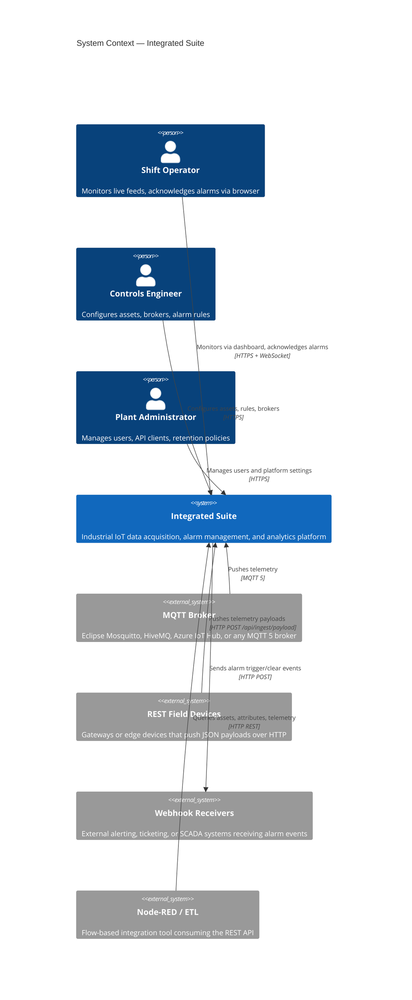

# C4 Context Diagram

**Confidence: High** — reflects implemented integration points.

---

## Level 1: System Context

---

## Key Interactions

| Actor / System | Interaction | Auth Method |
|----------------|------------|-------------|
| Browser Operator | View dashboards, live feed, alarms | UI session (localStorage profile) |
| Controls Engineer | CRUD assets, templates, brokers, rules | UI session + RBAC role check |
| REST Field Device | Push telemetry payload | API Key (`Authorization: Bearer` or `X-API-Key`) |
| MQTT Broker | Publish sensor data to subscribed topics | Credentials in broker config record |
| Webhook Receiver | Receive alarm notifications | Configured per alarm rule (no inbound auth) |
| Node-RED | Call REST endpoints | API Key with appropriate scope |
