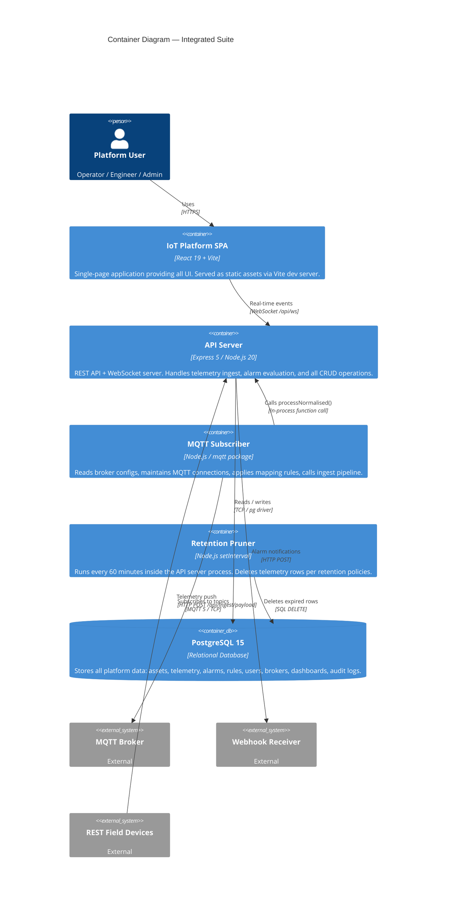

# C4 Container Diagram

**Confidence: High** — reflects implemented artifact structure and communication patterns.

---

## Level 2: Container Diagram

---

## Container Responsibilities

### IoT Platform SPA (`artifacts/iot-platform`)
- Renders all pages: dashboard, assets, alarms, visualization, live feed, reports, settings
- Manages user session in `localStorage` (selected role profile)
- Connects to WebSocket and dispatches telemetry/alarm events to subscribed components
- Generates React Query mutations for all write operations with actor header injection

### API Server (`artifacts/api-server`)
- Mounts all REST routes under `/api`
- Co-hosts WebSocket server on same HTTP server at `/api/ws`
- Runs ingest pipeline: normalise → write → evaluate expressions → evaluate alarms → broadcast
- Starts MQTT subscriber on boot (non-blocking)
- Runs hourly retention pruning in background `setInterval`

### PostgreSQL
- Single-node managed database
- 14 tables covering all platform domains
- Three composite indexes on `telemetry` for time-range and per-asset queries

---

## Network Communication

| From | To | Protocol | Path |
|------|----|---------|------|
| Browser | API | HTTP/1.1 | `/api/*` via reverse proxy |
| Browser | API | WebSocket | `/api/ws` via reverse proxy |
| API | PostgreSQL | TCP | `DATABASE_URL` connection string |
| MQTT Subscriber | MQTT Broker | TCP/MQTT | Configured host:port per broker |
| API | Webhook Receivers | HTTP POST | Configured URL per alarm rule |
| Vite Dev Server | — | — | Serves SPA at path `/` |
