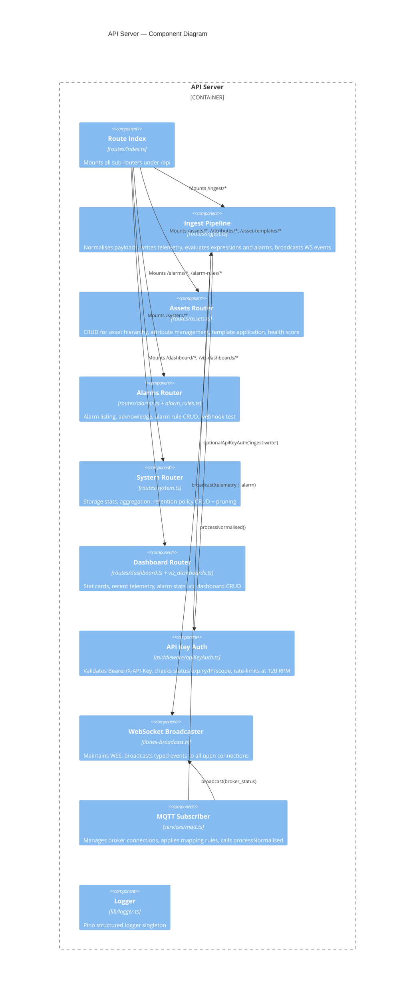
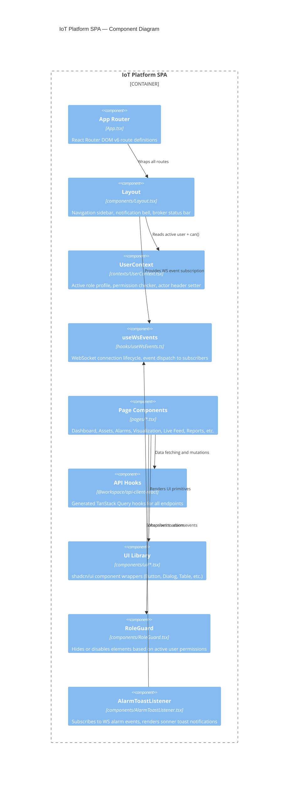
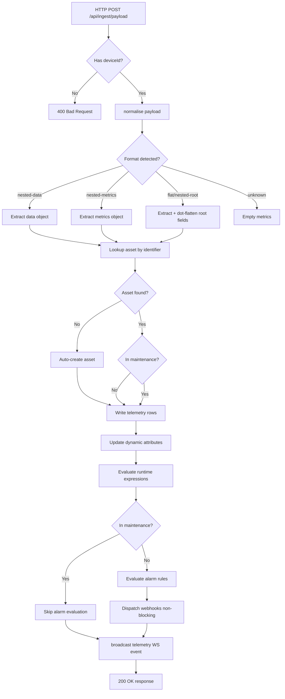

# C4 Component Diagram

**Confidence: High** — reflects actual file and module structure.

---

## Level 3: API Server Components

---

## Level 3: Frontend Components

---

## Ingest Pipeline — Internal Flow

