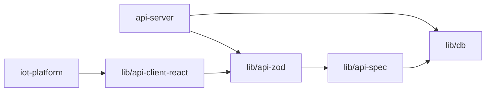

# Code Architecture

**Confidence: High** — based on actual monorepo file structure and import graph.

---

## Package / Module Structure

```
ws-integrated-suite/
├── artifacts/
│   ├── api-server/
│   │   ├── src/
│   │   │   ├── index.ts              — Server bootstrap, MQTT start, retention pruner
│   │   │   ├── app.ts                — Express app factory (middleware, router mount)
│   │   │   ├── lib/
│   │   │   │   ├── logger.ts         — Pino singleton
│   │   │   │   └── ws-broadcast.ts   — WebSocket server init + broadcast helper
│   │   │   ├── middleware/
│   │   │   │   └── apiKeyAuth.ts     — API key validation + rate limiter
│   │   │   ├── routes/
│   │   │   │   ├── index.ts          — Router aggregator
│   │   │   │   ├── ingest.ts         — Payload normaliser + processNormalised + alarm engine
│   │   │   │   ├── assets.ts         — Asset CRUD, attribute management, health score
│   │   │   │   ├── asset_templates.ts— Template CRUD + attribute blueprints
│   │   │   │   ├── attributes.ts     — Individual attribute CRUD
│   │   │   │   ├── alarms.ts         — Active alarm list + acknowledge
│   │   │   │   ├── alarm_rules.ts    — Alarm rule CRUD + webhook test
│   │   │   │   ├── brokers.ts        — Broker CRUD + MQTT restart
│   │   │   │   ├── broker_history.ts — Connection event log
│   │   │   │   ├── users.ts          — User CRUD
│   │   │   │   ├── api_clients.ts    — OAuth client credential management
│   │   │   │   ├── destinations.ts   — Webhook destination CRUD
│   │   │   │   ├── dashboard.ts      — Stat cards + recent telemetry + alarm stats
│   │   │   │   ├── viz_dashboards.ts — Persisted visualization dashboard CRUD
│   │   │   │   ├── system.ts         — Storage stats, aggregation, retention + pruning
│   │   │   │   ├── activity_log.ts   — Audit trail read + logActivity helper
│   │   │   │   ├── export.ts         — Report generation (Telemetry, Alarm, Asset Status)
│   │   │   │   └── health.ts         — GET /api/healthz
│   │   │   └── services/
│   │   │       └── mqtt.ts           — MQTT subscriber service
│   │   ├── build.mjs                 — esbuild bundler config
│   │   └── package.json
│   │
│   └── iot-platform/
│       ├── src/
│       │   ├── App.tsx               — Route definitions (React Router v6)
│       │   ├── main.tsx              — React DOM root + QueryClientProvider
│       │   ├── contexts/
│       │   │   └── UserContext.tsx   — RBAC context + setActorHeaders
│       │   ├── hooks/
│       │   │   └── useWsEvents.ts    — WebSocket client lifecycle
│       │   ├── components/
│       │   │   ├── Layout.tsx        — Sidebar nav + notification bell + broker bar
│       │   │   ├── RoleGuard.tsx     — Permission-gated wrapper
│       │   │   ├── AlarmToastListener.tsx
│       │   │   ├── BrokerStatusBar.tsx
│       │   │   ├── BrokerHistoryTimeline.tsx
│       │   │   └── ui/               — shadcn/ui component wrappers
│       │   ├── pages/
│       │   │   ├── Dashboard.tsx
│       │   │   ├── Assets.tsx
│       │   │   ├── AssetTemplates.tsx
│       │   │   ├── Alarms.tsx
│       │   │   ├── AlarmHistory.tsx
│       │   │   ├── AlarmRules.tsx
│       │   │   ├── Visualization.tsx
│       │   │   ├── LiveFeed.tsx
│       │   │   ├── Brokers.tsx
│       │   │   ├── Users.tsx
│       │   │   ├── ApiClients.tsx
│       │   │   ├── Destinations.tsx
│       │   │   ├── ActivityLog.tsx
│       │   │   ├── DataManagement.tsx
│       │   │   ├── Reports.tsx
│       │   │   └── NodeRedDocs.tsx
│       │   └── docs/                 — Integration guide content + generators
│       └── package.json
│
├── lib/
│   ├── api-spec/
│   │   ├── src/openapi.yaml          — OpenAPI 3.1 specification
│   │   └── orval.config.ts           — Codegen config (hooks + zod targets)
│   ├── api-client-react/
│   │   └── src/generated/            — Generated TanStack Query hooks + fetch client
│   ├── api-zod/
│   │   └── src/generated/api.ts      — Generated Zod schemas
│   └── db/
│       ├── src/
│       │   ├── index.ts              — db client export (drizzle + pool)
│       │   └── schema/               — Per-table schema files
│       │       ├── index.ts          — Barrel export of all tables
│       │       ├── assets.ts
│       │       ├── attributes.ts
│       │       ├── asset_templates.ts
│       │       ├── telemetry.ts
│       │       ├── alarms.ts
│       │       ├── alarm_rules.ts
│       │       ├── users.ts
│       │       ├── brokers.ts
│       │       ├── api_clients.ts
│       │       ├── destinations.ts
│       │       ├── activity_logs.ts
│       │       ├── broker_events.ts
│       │       ├── data_retention.ts
│       │       └── viz_dashboards.ts
│       └── drizzle.config.ts
│
└── scripts/
    └── src/
        └── hello.ts                  — Placeholder utility script
```

---

## Internal Dependency Graph



**Rules:**
- `artifacts/*` packages are leaf nodes — they never import from each other.
- `lib/*` packages are composite and may import sibling libs if declared in `references`.
- Codegen (`pnpm --filter @workspace/api-spec run codegen`) regenerates `lib/api-client-react` and `lib/api-zod` from the OpenAPI spec.

---

## Key Design Patterns

| Pattern | Where Used |
|---------|-----------|
| Repository via ORM | All route handlers query `db` (Drizzle) directly — no separate repository layer |
| Middleware factory | `apiKeyAuth(scope?)` and `optionalApiKeyAuth(scope?)` return middleware functions |
| Event broadcast | `broadcast(type, data)` iterates `wss.clients` — no pub/sub intermediary |
| Fire-and-forget async | Webhook delivery and DB usage tracking use `void promise` pattern |
| In-process background job | Retention pruner uses `setInterval` inside the server process |
| Code generation | OpenAPI spec → Orval → typed fetch client + React Query hooks + Zod schemas |
