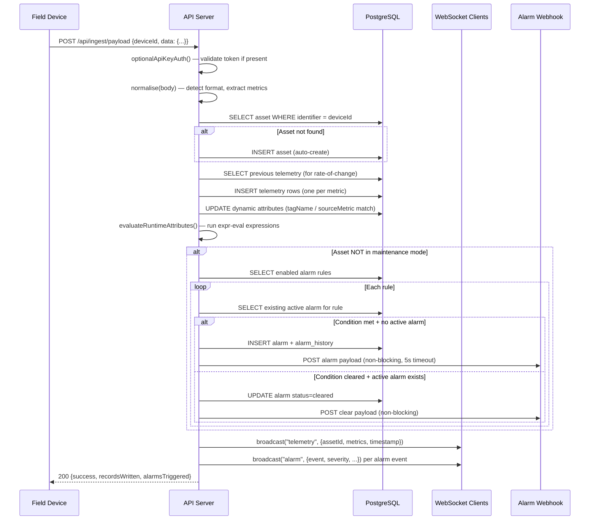
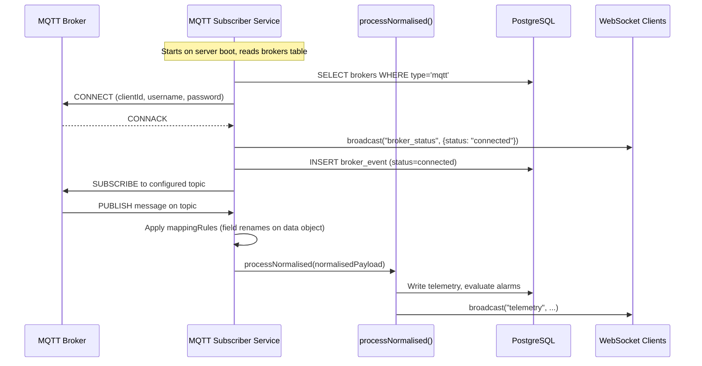
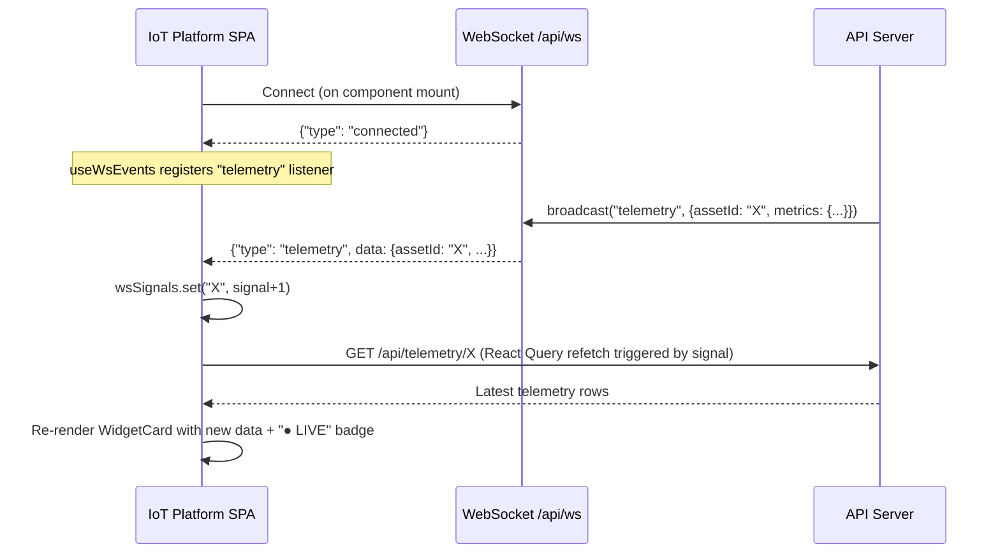
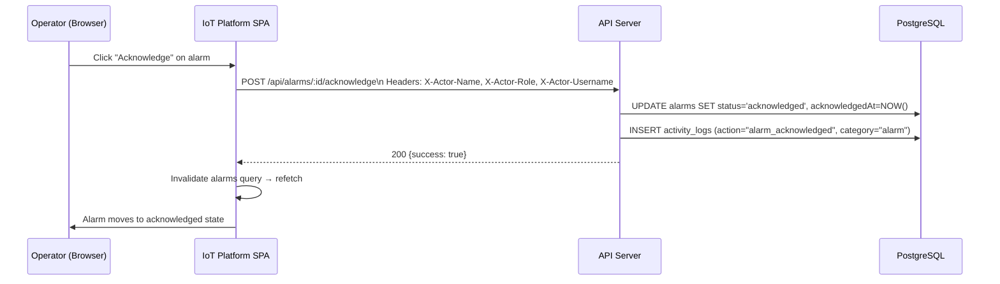
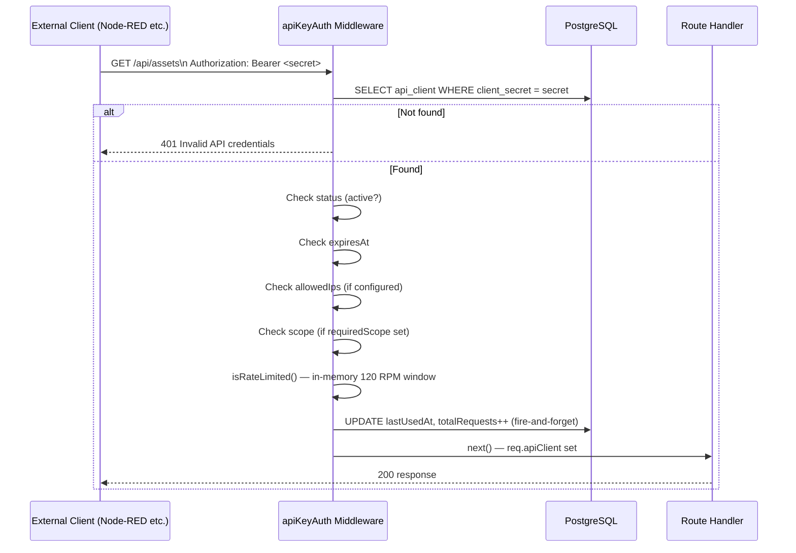
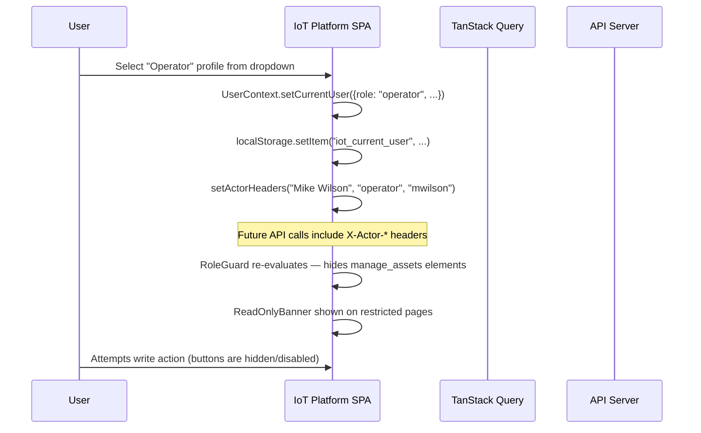

# Sequence Diagrams

**Confidence: High** — based on implemented route and service code.

---

## 1. Telemetry Ingest (HTTP)

---

## 2. MQTT Telemetry Ingest

---

## 3. Real-Time Dashboard Update

---

## 4. Alarm Acknowledge Flow

---

## 5. API Client Authentication

---

## 6. User Profile Switch (RBAC)

