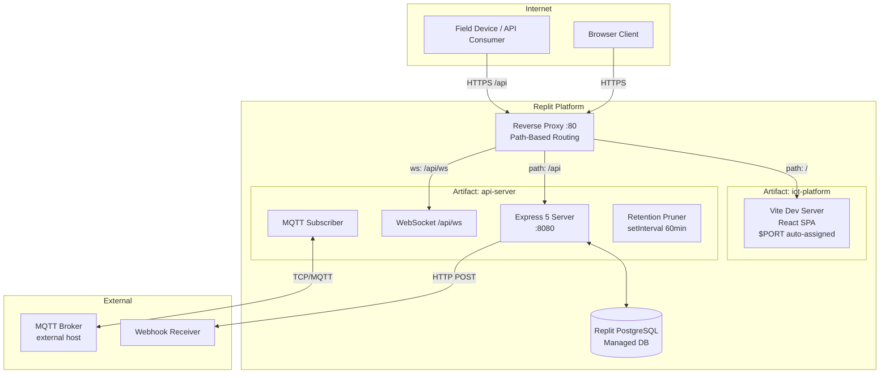

# Deployment Architecture

**Confidence: High** — based on `.replit`, `artifact.toml` config, and Replit platform behaviour.

---

## Deployment Topology



---

## Runtime Environments

| Environment | Description |
|-------------|------------|
| **Development** | Replit workspace — both artifacts run via workflow processes with hot reload |
| **Production** | Replit Deployment — artifacts built and served as production bundles |

---

## Artifact Configuration

Each artifact declares its service in `.replit-artifact/artifact.toml`:

**API Server (`artifacts/api-server`)**
```toml
[[services]]
localPort = 8080
name = "API Server"
paths = ["/api"]
```

**IoT Platform (`artifacts/iot-platform`)**
```toml
[[services]]
name = "web"
paths = ["/"]
```

---

## Hosting Model

| Concern | Approach |
|---------|---------|
| **Compute** | Single Replit container (shared CPU) |
| **Database** | Replit managed PostgreSQL (shared cluster) |
| **TLS** | Replit platform provides mTLS termination at the proxy |
| **DNS** | Replit provides `.replit.app` domain; custom domain configurable |
| **Static assets** | Served by Vite dev server in development; by Vite preview or CDN in production |
| **WebSocket** | Proxied through Replit reverse proxy over HTTPS (wss://) |

---

## Workflow Definitions

| Workflow | Command | Artifact |
|----------|---------|---------|
| `artifacts/api-server: API Server` | `pnpm --filter @workspace/api-server run dev` | api-server |
| `artifacts/iot-platform: web` | `pnpm --filter @workspace/iot-platform run dev` | iot-platform |

---

## Build Process

**API Server** — built with esbuild via `build.mjs`:
- Input: `src/index.ts`
- Output: `dist/index.mjs` (ESM bundle)
- Plugin: `esbuild-plugin-pino` (ensures pino transport files are co-located)

**IoT Platform** — built with Vite:
- Output: `dist/` (static assets)
- Base path: configured via `BASE_PATH` environment variable

---

## Environment Variables

| Variable | Scope | Description |
|----------|-------|-------------|
| `DATABASE_URL` | API Server | PostgreSQL connection string — provisioned by Replit |
| `SESSION_SECRET` | API Server | Secret for signing sessions |
| `PORT` | Both artifacts | HTTP port — assigned per artifact by Replit proxy |
| `NODE_ENV` | API Server | `development` or `production` |

---

## Scaling Considerations

The current architecture is single-node. To scale horizontally:

1. **WebSocket broadcast** — replace in-process `ws` broadcast with Redis Pub/Sub or a message broker (e.g. Redis, Kafka).
2. **Rate limiter** — migrate from in-memory `Map` to Redis-backed store.
3. **MQTT subscriber** — move to a dedicated worker process or use a message queue to distribute ingest load.
4. **Retention pruner** — migrate from `setInterval` to a proper cron job service or Replit Scheduled Deployments.

See [docs/review/architecture-review-report.md](../review/architecture-review-report.md) for full scalability assessment.
