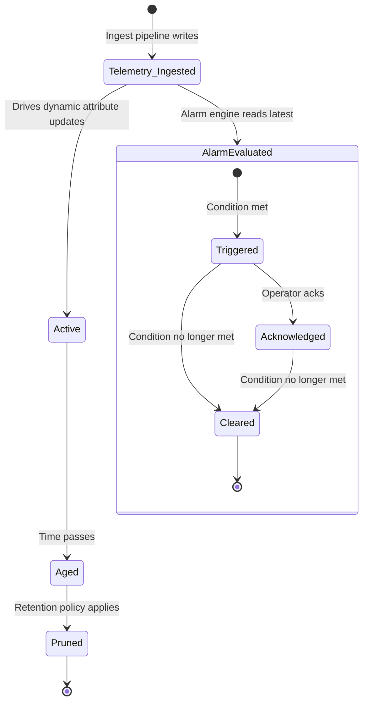

# Data Architecture

**Confidence: High** — based on implemented Drizzle schema.

---

## Data Domains

| Domain | Tables | Owner | Description |
|--------|--------|-------|-------------|
| **Asset Management** | `assets`, `attributes`, `asset_templates` | Controls Engineer | Physical and logical asset hierarchy with typed attributes |
| **Telemetry** | `telemetry` | Ingest Pipeline | Time-series sensor readings, append-only |
| **Alarm Management** | `alarms`, `alarm_history`, `alarm_rules` | Alarm Engine | Active alarms, historical records, rule definitions |
| **Visualization** | `viz_dashboards` | Platform User | Persisted dashboard configurations |
| **Connectivity** | `brokers`, `broker_events` | Controls Engineer | Broker configs and connection event log |
| **Security** | `api_clients`, `destinations` | Administrator | Machine credentials and webhook destinations |
| **Users** | `users` | Administrator | Platform user accounts and roles |
| **Operations** | `data_retention_policies` | Administrator | Retention rules for telemetry pruning |
| **Audit** | `activity_logs` | System | Immutable write operation audit trail |

---

## Data Ownership

| Table | Created By | Modified By | Deleted By |
|-------|-----------|-------------|-----------|
| `assets` | User / Ingest auto-create | User | User |
| `attributes` | User / Template apply | Ingest (dynamic) | User |
| `telemetry` | Ingest pipeline only | Never | Retention pruner only |
| `alarms` | Alarm engine only | Alarm engine (status) / User (acknowledge) | Never |
| `alarm_history` | Alarm engine only | Alarm engine (cleared) | Never |
| `alarm_rules` | User | User | User |
| `activity_logs` | System (logActivity helper) | Never | Never |
| `broker_events` | MQTT service | Never | Never |

---

## Data Lifecycle

### Telemetry Lifecycle
1. **Ingested** — written by ingest pipeline (HTTP or MQTT)
2. **Active** — queryable via telemetry endpoints, drives dynamic attributes
3. **Aged** — older than retention policy threshold
4. **Pruned** — deleted by hourly background job

### Alarm Lifecycle
1. **active** — condition triggered, visible on alarm page
2. **acknowledged** — operator noted, still active
3. **cleared** — condition no longer met, moved to alarm history

---

## Data Governance

| Policy | Implementation |
|--------|---------------|
| **Immutability** | `telemetry`, `activity_logs`, `broker_events` rows are never updated or deleted by normal operations |
| **Retention** | Configurable per-asset and per-metric via `data_retention_policies`; default: no expiry |
| **Audit** | All write operations recorded in `activity_logs` with actor identity and timestamp |
| **Timestamps** | All tables use `TIMESTAMPTZ` (UTC) for all timestamp fields |
| **UUIDs** | All primary keys are UUIDs (random); no sequential integers exposed to external systems |
| **Quality flags** | Telemetry and attributes carry a `quality` field (`good` / `bad` / `uncertain`) |

---

## Data Volume Estimates

| Table | Growth Rate | Retention |
|-------|------------|-----------|
| `telemetry` | High — one row per metric per ingest event | Configurable (default: none) |
| `activity_logs` | Medium — one row per write operation | No built-in retention |
| `broker_events` | Low — one row per connection event | No built-in retention |
| `alarms` | Low — only active alarms; cleared alarms remain | No built-in retention |
| `alarm_history` | Medium — copy of each alarm lifecycle event | No built-in retention |

**Recommendation:** Add retention policies for `activity_logs` and `alarm_history` in a future release.
