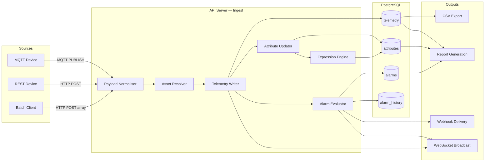
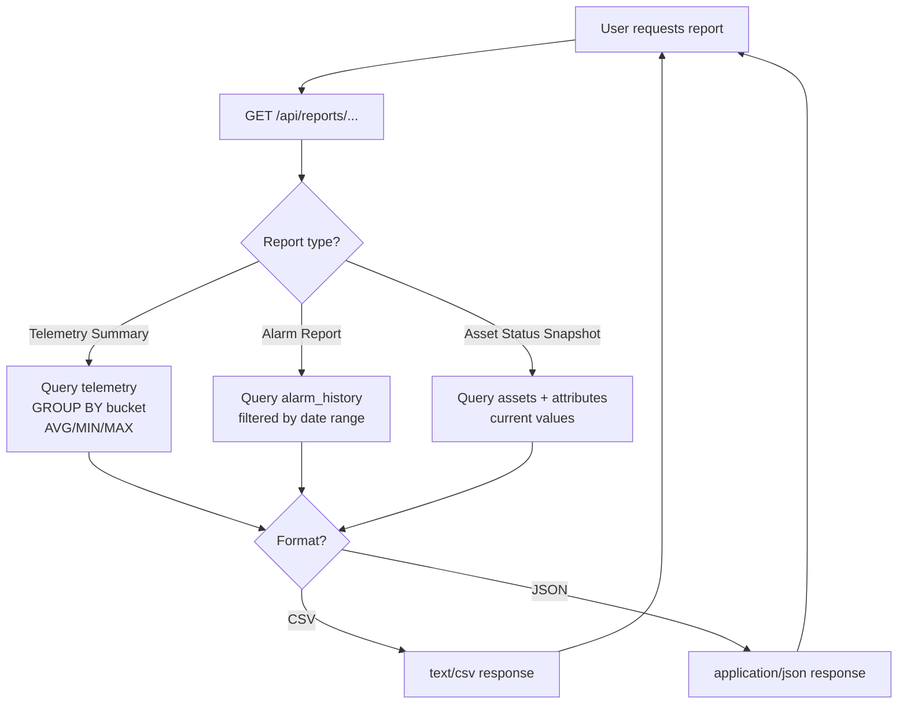

# Data Flow

**Confidence: High** — based on ingest pipeline, MQTT service, and WebSocket broadcast code.

---

## End-to-End Data Movement



---

## Ingest Payload Formats

### Format 1: Nested-Data (`payloadFormat: "nested-data"`)
```json
{
  "deviceId": "energy-meter-01",
  "timestamp": "2025-01-14T10:00:00Z",
  "sensor": { "serial": "SN-123" },
  "data": {
    "grid.consumed_kWh": 15.4,
    "solar.generated_kWh": 9.2
  }
}
```

### Format 2: Nested-Metrics (`payloadFormat: "nested-metrics"`)
```json
{
  "deviceId": "fan-controller-01",
  "timestampUnix": 1736845200,
  "metrics": {
    "vibration": 3.2,
    "temperature": 72.1
  }
}
```

### Format 3: Flat (`payloadFormat: "flat"`)
```json
{
  "deviceId": "sensor-001",
  "temperature": 25.3,
  "humidity": 62.1,
  "timestamp": "2025-01-14T10:00:00Z"
}
```

### Format 4: Nested-Root (`payloadFormat: "nested-root"`)
```json
{
  "deviceId": "gateway-01",
  "chiller": { "energy_kWh": 15.2, "load_percent": 82 },
  "lighting": { "power_factor": 0.95 }
}
```
Results in metrics: `chiller.energy_kWh`, `chiller.load_percent`, `lighting.power_factor`.

---

## Attribute Update Flow

When a telemetry record is written, the ingest pipeline updates attributes in two ways:

1. **tagName match** — `UPDATE attributes SET value=? WHERE assetId=? AND tagName = 'deviceId.metric'`
2. **sourceMetric match** — `UPDATE attributes SET value=? WHERE assetId=? AND sourceMetric = 'metric'`

This allows attributes to be bound to specific device metrics regardless of device identifier.

---

## WebSocket Event Types

| Type | Payload | Trigger |
|------|---------|---------|
| `connected` | `{}` | On WebSocket connection established |
| `telemetry` | `{assetId, assetName, metrics, timestamp}` | After every successful ingest |
| `alarm` | `{event, alarmId, ruleName, metric, value, severity, assetId, assetName, timestamp}` | On alarm trigger or clear |
| `broker_status` | `{brokerId, brokerName, status, message}` | On MQTT connect / disconnect / error |

---

## Report Data Flow


