# Data Model

**Confidence: High** — derived directly from Drizzle ORM schema files.

---

## Entity-Relationship Diagram

```mermaid
erDiagram
    assets {
        uuid id PK
        text name
        text identifier
        uuid parentId FK
        boolean maintenanceMode
        timestamp maintenanceSince
        text maintenanceNote
        timestamp createdAt
        timestamp updatedAt
    }

    attributes {
        uuid id PK
        uuid assetId FK
        text name
        text type "static|dynamic|metric|runtime"
        text dataType "text|number|double|boolean|timestamp"
        text tagName
        text sourceMetric
        text uom
        text value
        text expression
        integer decimalPlaces
        boolean thousandSeparator
        text quality "good|bad|uncertain"
        timestamp timestamp
    }

    asset_templates {
        uuid id PK
        text name
        text[] tags
        integer attributeCount
        jsonb attributeDefinitions
        timestamp createdAt
        timestamp updatedAt
    }

    telemetry {
        uuid id PK
        uuid assetId FK
        text deviceId
        text metric
        jsonb value
        text quality
        timestamp timestamp
    }

    alarms {
        uuid id PK
        text name
        uuid assetId FK
        text assetName
        uuid ruleId FK
        text severity "critical|high|medium|low|info"
        text status "active|acknowledged|cleared"
        text alarmClass
        text message
        jsonb triggerValue
        timestamp triggeredAt
        timestamp acknowledgedAt
        timestamp clearedAt
    }

    alarm_history {
        uuid id PK
        uuid alarmId FK
        uuid assetId FK
        text assetName
        text name
        text severity
        text status
        timestamp triggeredAt
        timestamp clearedAt
    }

    alarm_rules {
        uuid id PK
        text name
        uuid assetId FK
        text metric
        text alarmType "threshold|rate_of_change|heartbeat|deviation"
        text operator "gt|lt|gte|lte|eq|ne"
        real threshold
        real deadband
        text severity
        boolean enabled
        text webhookUrl
        boolean webhookEnabled
        integer rocWindow
        timestamp createdAt
    }

    users {
        uuid id PK
        text username
        text email
        text fullName
        text role "admin|engineer|operator|viewer"
        text status "active|inactive|suspended"
        text passwordHash
        timestamp lastLogin
        timestamp createdAt
    }

    brokers {
        uuid id PK
        text name
        text type "mqtt|rest|azure"
        text host
        integer port
        text status
        text mqttUsername
        text mqttPassword
        text mqttTopic
        text mqttClientId
        jsonb mappingRules
        timestamp createdAt
        timestamp updatedAt
    }

    broker_events {
        uuid id PK
        uuid brokerId FK
        text brokerName
        text status "connected|disconnected|error"
        text message
        timestamp timestamp
    }

    api_clients {
        uuid id PK
        text name
        text clientId
        text clientSecret
        text[] scopes
        text status "active|inactive|revoked"
        timestamp expiresAt
        text[] allowedIps
        text description
        timestamp secretRotatedAt
        integer totalRequests
        timestamp lastUsedAt
        timestamp createdAt
    }

    destinations {
        uuid id PK
        text name
        text url
        text method
        jsonb headers
        boolean enabled
        text[] eventTypes
        text authType
        text authValue
        timestamp createdAt
    }

    activity_logs {
        uuid id PK
        text action
        text category
        text actorName
        text actorRole
        text actorUsername
        text targetId
        text targetName
        text detail
        timestamp timestamp
    }

    data_retention_policies {
        uuid id PK
        text name
        uuid assetId FK
        text metric
        integer retentionDays
        boolean enabled
        timestamp lastPrunedAt
        integer rowsPruned
    }

    viz_dashboards {
        uuid id PK
        text name
        text roleFilter
        text assetFilter
        jsonb widgets
        timestamp createdAt
        timestamp updatedAt
    }

    assets ||--o{ assets : "parent"
    assets ||--o{ attributes : "has"
    assets ||--o{ telemetry : "receives"
    assets ||--o{ alarms : "has"
    alarms ||--o{ alarm_history : "archived as"
    alarm_rules ||--o{ alarms : "triggers"
    brokers ||--o{ broker_events : "logs"
    assets ||--o{ data_retention_policies : "governed by"
```



---

## Table Descriptions

### `assets`
Hierarchical asset tree. `parentId = null` denotes root nodes (projects). Self-referencing FK supports unlimited depth. `maintenanceMode` suppresses alarm evaluation without removing rules.

### `attributes`
Four attribute types:
- **static** — manually set, read-only value (e.g. serial number, installation date)
- **dynamic** — updated by ingest pipeline via `tagName` or `sourceMetric` matching
- **metric** — maps to a telemetry metric key; displayed on trend charts
- **runtime** — computed from `expression` (expr-eval) using other attribute values as variables

### `telemetry`
Append-only time-series store. `value` is `JSONB` to support numeric, string, and boolean readings. Three composite indexes:
- `(asset_id, metric, timestamp DESC)` — point queries and trend charts
- `(timestamp DESC)` — global time-range queries
- `(asset_id, timestamp DESC)` — per-asset time-range queries

### `alarm_rules`
Supports `threshold`, `rate_of_change`, `heartbeat`, and `deviation` types. Only `threshold` and `rate_of_change` are currently evaluated by the alarm engine. `deadband` prevents flapping: alarm does not clear until value recovers by `deadband` units.

### `api_clients`
Machine OAuth credentials. `clientSecret` stored in plaintext (not hashed). `scopes` array controls access; empty array = super-key (all scopes). `allowedIps` array; empty = allow all.

### `viz_dashboards`
`widgets` is a JSONB array of widget configuration objects. Widget layout (position, size) is client-managed and stored in `localStorage`; only the configuration (type, asset, metric, SPC values, overlays) is persisted in the database.

---

## Key Indexes

```sql
-- Telemetry performance indexes
CREATE INDEX idx_telemetry_asset_metric_ts ON telemetry(asset_id, metric, timestamp DESC);
CREATE INDEX idx_telemetry_ts ON telemetry(timestamp DESC);
CREATE INDEX idx_telemetry_asset_ts ON telemetry(asset_id, timestamp DESC);
```
