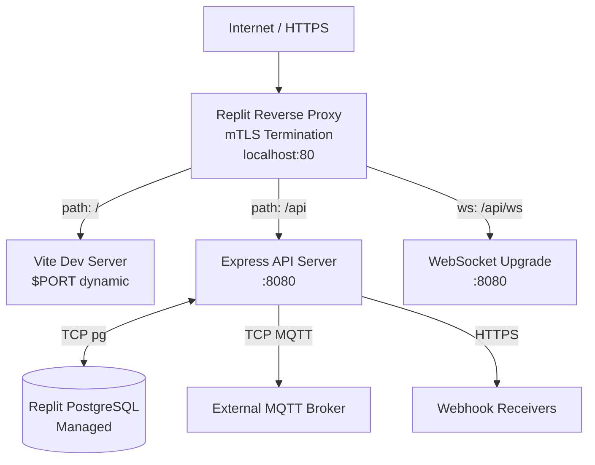

# Infrastructure

**Confidence: Medium** — Replit platform internals are not directly observable; documented based on known Replit deployment model.

---

## Network Architecture

### Path-Based Routing Rules
- `/api/*` → API Server (port 8080) — most specific prefix wins
- `/` → IoT Platform SPA (Vite dev server, dynamic port)
- WebSocket upgrades to `/api/ws` → API Server

### TLS / Security
- All external traffic is terminated at the Replit proxy over HTTPS (TLS 1.2+)
- Inter-container traffic (proxy → services) uses mTLS
- Direct port access (e.g., localhost:8080) is blocked from external network

---

## Compute

| Resource | Specification |
|----------|--------------|
| Runtime | Node.js 20 (NixOS-based Replit container) |
| CPU | Shared vCPU (Replit Hacker / Pro tier) |
| Memory | Shared pool (typically 512 MB – 2 GB depending on plan) |
| Processes | 2 long-running: API Server + Vite Dev Server |
| Background threads | 1 MQTT subscriber (in API server process), 1 retention pruner (setInterval) |

---

## Database

| Property | Value |
|----------|-------|
| Engine | PostgreSQL 15 |
| Hosting | Replit managed PostgreSQL |
| Connection | `DATABASE_URL` environment variable (connection string with SSL) |
| Connection pooling | `node-postgres` Pool (default pool size) |
| Migrations | Drizzle Kit (`pnpm --filter @workspace/db run migrate`) |
| Backups | Managed by Replit platform |

---

## Storage

| Type | Location | Managed By |
|------|----------|-----------|
| Relational data | PostgreSQL | Replit |
| Dashboard widget layout | Browser `localStorage` | Client-side |
| User session profile | Browser `localStorage` (`iot_current_user`) | Client-side |
| Static assets | Vite dev server (in-process) | Vite / Replit |
| Build artifacts | `dist/` directories (per artifact) | esbuild / Vite |

---

## Scaling

### Current State (Single Node)
The platform runs as a single-node deployment. All state is in PostgreSQL and the two process memories. This means:
- WebSocket connections are handled by one process
- Rate limiting state is in-memory (resets on restart)
- MQTT subscriptions are managed by one process
- No load balancer

### Path to Horizontal Scaling

| Component | Required Change |
|-----------|----------------|
| WebSocket broadcast | Replace with Redis Pub/Sub; all nodes subscribe and relay |
| Rate limiter | Replace in-memory `Map` with Redis atomic increment |
| MQTT subscriber | Extract to dedicated worker process with message queue |
| Retention pruner | Replace `setInterval` with external cron / Replit Scheduled Deployment |
| Session | Already stateless (localStorage-based RBAC) — no change needed |

---

## Cost Considerations

| Resource | Cost Driver |
|----------|------------|
| PostgreSQL storage | Telemetry table grows with ingest frequency; managed by retention policies |
| Compute | Two always-on processes; Replit Pro recommended for production |
| Egress | Webhook delivery to external endpoints; WebSocket data for active dashboards |
| MQTT connections | One TCP connection per configured broker; minimal cost |
