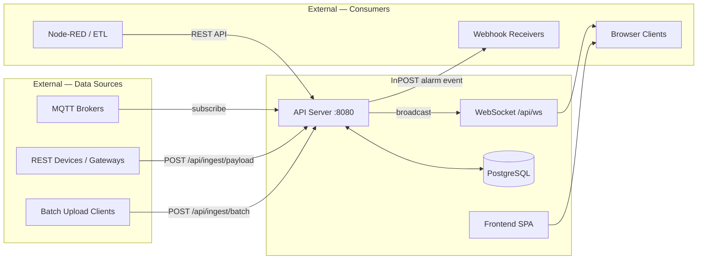

# System Landscape

**Confidence: High** — based on implemented broker, ingest, and webhook code.

---

## System Boundaries

Integrated Suite is a self-contained platform that accepts telemetry from external field devices and optionally pushes alarm notifications to external systems.

---

## External Dependencies

| System | Direction | Protocol | Purpose |
|--------|-----------|----------|---------|
| MQTT Broker (any) | Inbound | MQTT 5 | Field device telemetry |
| Azure IoT Hub | Inbound | MQTT/REST | Azure-connected device telemetry |
| REST Devices / Gateways | Inbound | HTTP POST | Direct payload push |
| Webhook Receivers | Outbound | HTTP POST | Alarm trigger/clear notifications |
| Node-RED | Bidirectional | HTTP REST | Flow-based integration |
| PostgreSQL | Internal | TCP/pg | Primary datastore |
| Browser Clients | Inbound | HTTP + WebSocket | Human operators |

---

## Upstream Systems (Data Producers)

| System | Integration Point | Notes |
|--------|------------------|-------|
| MQTT Broker | `brokers` table + MQTT subscriber service | Managed connection; payload mapping rules applied |
| Field REST Devices | `POST /api/ingest/payload` | Requires `Authorization: Bearer` or `X-API-Key` if scope enforced |
| Batch ETL | `POST /api/ingest/batch` | Array payload, sequential processing |
| Node-RED Flows | REST API endpoints | See Integration Guide in UI |

---

## Downstream Systems (Data Consumers)

| System | Integration Point | Notes |
|--------|------------------|-------|
| Alarm Webhook Receivers | Configured per alarm rule | 5 s timeout, non-blocking, silent failure |
| Browser Dashboards | WebSocket `/api/ws` | Push: `telemetry` + `alarm` + `broker_status` event types |
| CSV Export Clients | `GET /api/telemetry/:id/export` | Up to 50,000 rows per request |
| Report Consumers | `GET /api/reports/*` | On-demand aggregated data |
