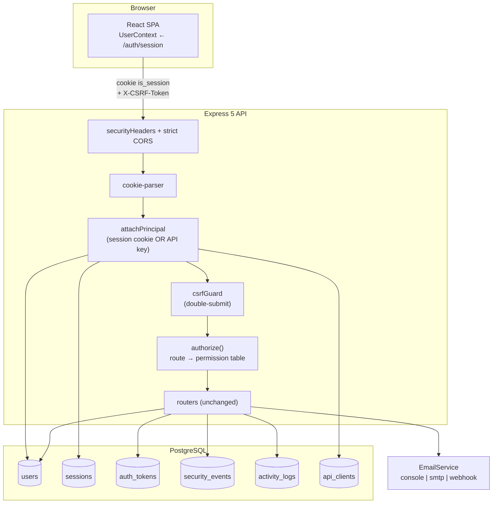
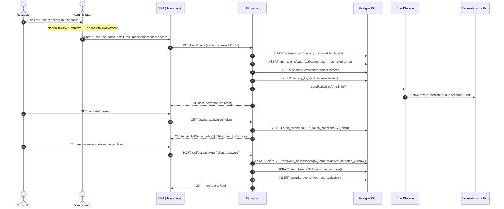
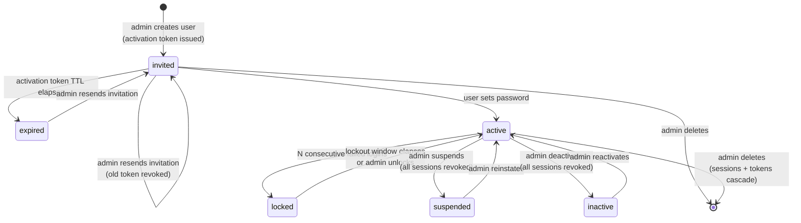
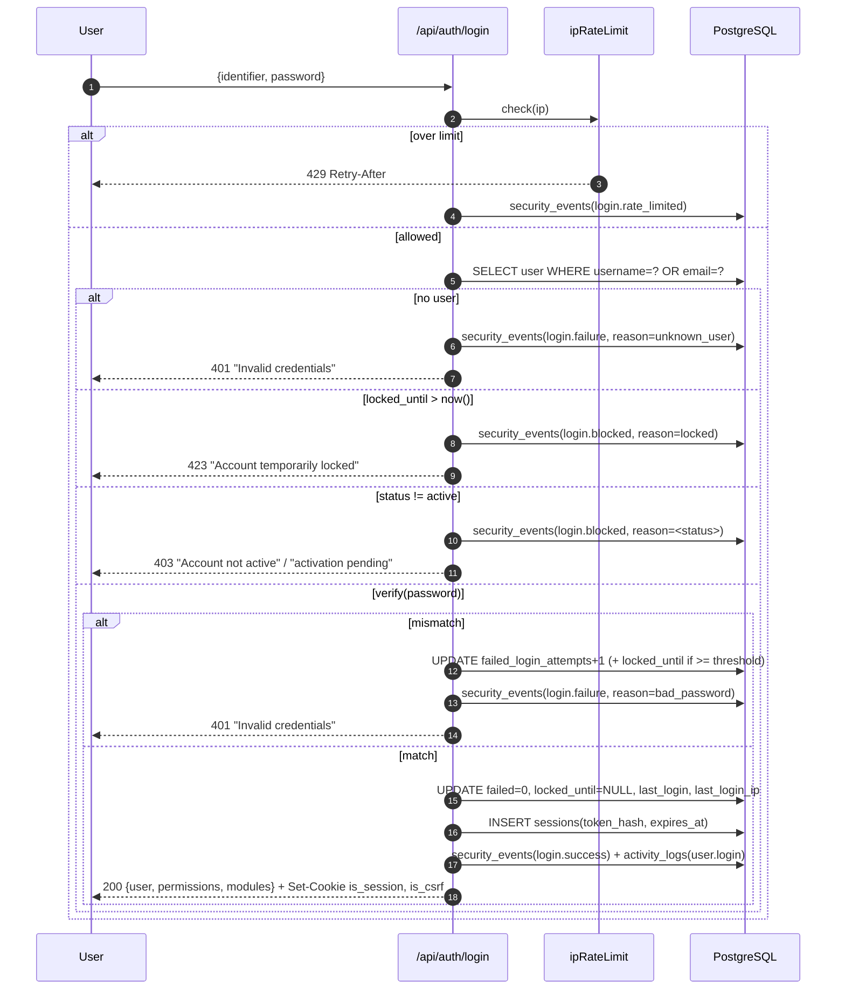
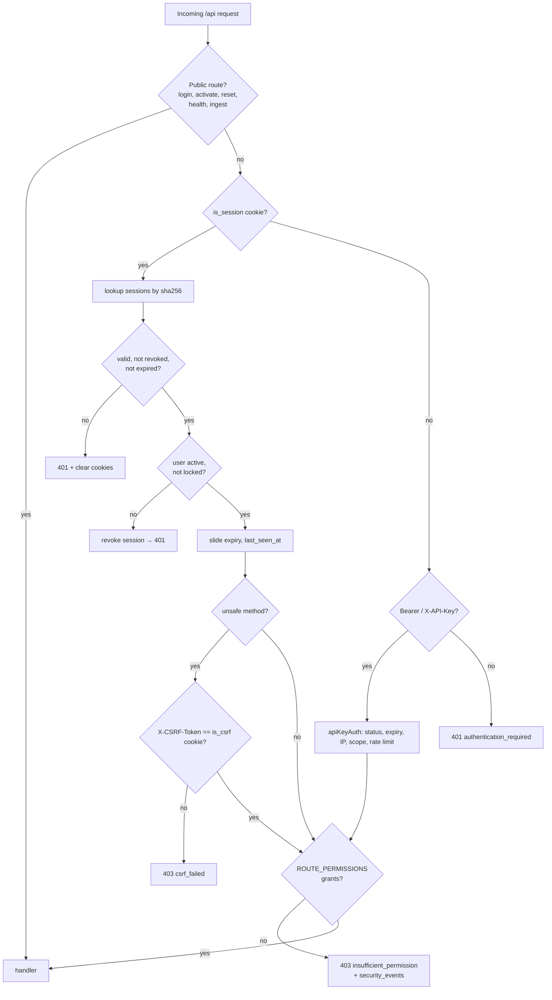
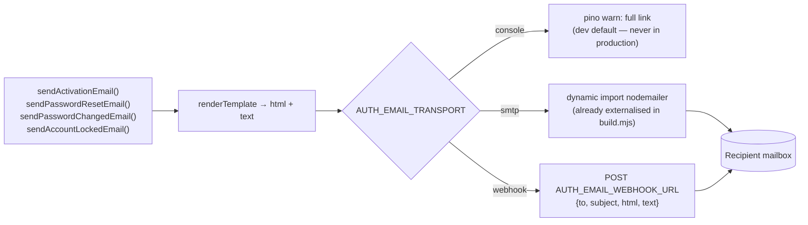

# Enterprise Authentication & Invitation-Based Onboarding

Assessment, target design, and implementation record for the upgrade of the Integrated Suite
authentication/authorisation stack from "demo-grade" to production-grade.

Audience: platform engineers and security reviewers. Companion ADR: `docs/adr/`.

---

## Phase 1 — Existing platform assessment

### 1.1 Authentication architecture (as-was)

| Concern | Where | Behaviour |
|---|---|---|
| Human login | `artifacts/api-server/src/routes/auth.ts` | `POST /api/auth/login`, looks up `users` by username **or** email, compares `user.passwordHash !== password` — **plaintext string equality** |
| Credential storage | `lib/db/src/schema/users.ts` | `password_hash text` — despite the name, holds the cleartext password |
| Seeded credentials | `lib/db/src/seed.ts` | `admin/admin123`, `jsmith/engineer123`, `mwilson/operator123` — printed to stdout |
| Session | none | Server returns the sanitised user object; the SPA stores it in `localStorage` under `iot_current_user` plus a `ws_authed="1"` flag |
| Request identity | `lib/api-client-react/src/custom-fetch.ts` | `X-Actor-Name` / `X-Actor-Role` / `X-Actor-Username` headers, **set by the client, trusted by the server** |
| Machine auth | `artifacts/api-server/src/middleware/apiKeyAuth.ts` | Bearer / `X-API-Key` against `api_clients.client_secret` (plaintext), with scopes, IP allowlist, expiry, 120 rpm limiter |
| Password change | `routes/users.ts` `PATCH /users/:id/change-password` | Plaintext compare, min length 6, no re-auth, **no authorisation check — any caller can change any user's password** |
| Password reset | `pages/Login.tsx` | Pure UI theatre: sets local state, tells the user to phone an administrator. No server call |
| Logout | — | Not implemented server-side |

### 1.2 Authorisation architecture (as-was)

Three *separate, unsynchronised* permission models existed:

1. **`ROLE_PERMISSIONS`** — `artifacts/iot-platform/src/contexts/UserContext.tsx`. Nine coarse verbs
   (`view`, `manage_assets`, `manage_users`, …) for four roles. Consumed by `can()` →
   `RoleGuard` / `ReadOnlyBanner`. Frontend only.
2. **`MODULES` + `ROLE_DEFAULTS` + per-user overrides** — `artifacts/iot-platform/src/pages/Users.tsx`.
   Twelve modules, `simple` (on/off) or `granular` (R/W/D), plus project / dashboard / analytics
   allowlists. Persisted to **`localStorage` key `iot_access_v3`** — i.e. per-browser, not per-user,
   never sent to the server, and **read by nothing except the editor that writes it**.
3. **API-client scopes** — `api_clients.scopes`, enforced by `apiKeyAuth`, applied to exactly
   7 of ~120 routes (`/export/*`, `/ingest/*`).

### 1.3 Existing security capabilities worth keeping

These are genuinely good and are **reused unchanged** by this upgrade:

- `activity_logs` table + `logActivity()` helper with live WebSocket broadcast.
- `api_clients` with scopes, IP allowlist, expiry, rotation timestamp, usage counters.
- The `apiKeyAuth` middleware shape (status → expiry → IP → scope → rate limit) — a good template.
- `RoleGuard` / `ReadOnlyBanner` components and the `can(permission)` call sites across ~20 pages.
- The `MODULES` / `ROLE_DEFAULTS` matrix and its Access Control editor UI.
- OpenAPI-first codegen chain (`lib/api-spec` → `lib/api-zod` + `lib/api-client-react`).

### 1.4 Security weaknesses (ranked)

| # | Severity | Finding | Evidence |
|---|---|---|---|
| W1 | **Critical** | Passwords stored and compared in cleartext | `auth.ts:25`, `users.ts:44`, `users.ts:119` |
| W2 | **Critical** | **No server-side authorisation whatsoever.** Every route except 7 is fully anonymous. `curl -X DELETE /api/users/<id>` works with no credential | `routes/index.ts`, absence of middleware |
| W3 | **Critical** | Known default credentials shipped in seed and printed to console | `seed.ts:59,68,77,84` |
| W4 | **Critical** | Identity is client-asserted. `X-Actor-Role: admin` on any request forges the audit trail | `activity_log.ts:22-24` |
| W5 | **High** | Auth state is a `localStorage` boolean (`ws_authed="1"`). Setting it in devtools grants the full UI | `App.tsx:51` |
| W6 | **High** | `PATCH /users/:id/change-password` has no caller authorisation — horizontal privilege escalation | `users.ts:104` |
| W7 | **High** | No brute-force protection on `/auth/login`; the 120 rpm limiter is per-*API-client* and login has no API client | `apiKeyAuth.ts:19` |
| W8 | **High** | No sessions ⇒ no timeout, no revocation, no logout, no "sign out everywhere" | — |
| W9 | **High** | `api_clients.client_secret` stored in cleartext and matched by equality | `apiKeyAuth.ts:54` |
| W10 | Medium | No CSRF defence (irrelevant while there are no cookies; becomes relevant the moment sessions land) | `app.ts` |
| W11 | Medium | `cors()` with no options ⇒ `Access-Control-Allow-Origin: *` | `app.ts:28` |
| W12 | Medium | No security response headers (HSTS, X-Content-Type-Options, frame-ancestors, referrer policy) | `app.ts` |
| W13 | Medium | Password policy = `length >= 6`, only on one endpoint; `POST /users` has none | `users.ts:112` |
| W14 | Medium | No login history, no failed-login record, no security event stream | schema |
| W15 | Medium | Per-user access grants live in `localStorage` — not authoritative, not portable, not auditable | `Users.tsx:105` |
| W16 | Low | No account lifecycle: users are born `active` with an admin-chosen password; no invitation, activation, or expiry | `users.ts:36` |
| W17 | Low | No MFA, no SSO/OIDC seam | — |

### 1.5 Gap analysis vs. the requirement

| Required capability | Status before | Action |
|---|---|---|
| Admin-only user creation, no self-registration | ✅ already true (no signup route/UI) | **Preserve**, add a negative test |
| RBAC roles + permissions | ⚠️ exists, frontend-only | **Reuse verbs, add server enforcement** |
| Dashboard / module / feature access | ⚠️ exists, `localStorage`-only | **Reuse the matrix, move storage to DB, serve from API** |
| R/W/U/D permissions | ⚠️ R/W/D exists (no separate U) | **Reuse; `update` folds into `write` — documented** |
| Password hashing | ❌ | **Add** — scrypt (`node:crypto`, no new dependency) |
| Password policy | ❌ | **Add** — shared validator, all write paths |
| Invitation → activation → first login | ❌ | **Add** |
| Secure password reset | ❌ | **Add** |
| Email delivery | ❌ | **Add** — pluggable transport (console / SMTP / webhook) |
| Failed-login tracking, lockout, rate limit | ❌ | **Add** |
| Session management + timeout | ❌ | **Add** — DB-backed opaque token in an httpOnly cookie |
| CSRF | ❌ | **Add** — double-submit cookie |
| Audit logging | ✅ `activity_logs` | **Reuse** |
| Security event / login history | ❌ | **Add** — one `security_events` table |
| MFA / SSO / OIDC readiness | ❌ | **Add schema seam + config seam**, no runtime implementation |
| API token management | ✅ `api_clients` | **Reuse**, harden secret storage |

### 1.6 Improvement opportunities (deliberately out of scope, recorded)

- Hash `api_clients.client_secret` (breaking change for existing integrations — needs a rotation window).
- Replace the in-memory rate-limit buckets with Redis when the API runs more than one instance.
- Fine-grained *row-level* asset scoping (today the project allowlist is enforced at the API boundary,
  not inside every query).

---

## Phase 2 — Target solution design

### 2.1 Future-state architecture



Key properties:

- **The server is the only authority.** `X-Actor-*` headers are ignored for authenticated
  requests — the actor is derived from the session. (They remain honoured for unauthenticated
  internal/system calls so existing `logActivity` call sites keep working.)
- **One principal type, two credentials.** A request is authenticated by *either* a session
  cookie (human) or an API key (machine); both resolve to a `req.principal` carrying an
  effective permission set. Downstream authorisation code doesn't care which.
- **One permission model.** The server owns the catalogue (roles → verbs → modules); the SPA
  renders from what `/auth/session` hands it. No second copy to drift.

### 2.2 Invitation and activation workflow



### 2.3 User lifecycle



`status` values: `invited`, `active`, `suspended`, `inactive`. `locked` is *not* a status — it is
`locked_until > now()` on an otherwise-`active` row, so a lockout auto-heals without an admin edit.
`expired` is derived (status `invited` + no live activation token), not stored.

### 2.4 Authorisation enhancement design

Effective permission resolution, evaluated **server-side** on every request and returned to the SPA:

```
role  ──► ROLE_PERMISSIONS[role]        (verbs: view, manage_assets, …)   ── existing, unchanged
      ──► ROLE_MODULE_DEFAULTS[role]    (module → true | {r,w,d})         ── existing, moved server-side
                    │
user.access_overrides (jsonb)  ──► deep-merge over the defaults
                    │
                    ▼
        { permissions: string[], modules: {…}, restrictProjects, allowedProjects,
          restrictDashboards, allowedDashboards, restrictAnalytics, allowedAnalytics }
```

Enforcement points:

| Layer | Mechanism |
|---|---|
| API — coarse | `ROUTE_PERMISSIONS` table in `middleware/authorize.ts`, matched by method + path, applied once in `app.ts`. No route file changes. |
| API — resource | Per-route checks where the object identity matters (e.g. `/viz-dashboards/:id` against `allowedDashboards`). |
| SPA — route | `<Protected module="users">` wrapper in `App.tsx`; unauthorised routes render a 403 page, not a blank screen. |
| SPA — nav | `Layout.tsx` filters nav items by module access. |
| SPA — control | Existing `RoleGuard permission="…"` — **unchanged call sites**, now fed by server truth. |

`update` is not a distinct grant: the existing matrix is R/W/D and every write path in the codebase
treats create and update identically. `write` therefore covers create + update; this is documented
rather than invented, to avoid a second permission vocabulary.

### 2.5 Security architecture

| Control | Choice | Rationale |
|---|---|---|
| Password hash | **scrypt** (`node:crypto`), `N=2^16, r=8, p=2`, 16-byte salt, 64-byte key | OWASP-approved; zero new dependencies, so it survives the `minimumReleaseAge: 1440` policy and needs no native build on Replit. Stored as `scrypt$N$r$p$salt$hash` so argon2id can be swapped in later behind the same verify(). |
| Hash comparison | `crypto.timingSafeEqual` | Constant-time |
| Session token | 32 random bytes, base64url; **SHA-256 stored**, raw value only in the cookie | DB compromise does not yield usable sessions |
| Session cookie | `is_session`; `HttpOnly`, `SameSite=Lax`, `Secure` in production, `Path=/` | XSS cannot read it; Lax blocks cross-site POST |
| Session lifetime | 30 min idle / 12 h absolute (both env-configurable) | Rolling renewal on each authenticated request |
| CSRF | Double-submit: non-`HttpOnly` `is_csrf` cookie + `X-CSRF-Token` header, required on cookie-authenticated unsafe methods | API-key callers are exempt (they send no cookie, so they are not confusable-deputy targets) |
| Activation / reset tokens | 32 random bytes, SHA-256 stored, single-use, typed, TTL 72 h / 60 min | Single-use + hash-at-rest + type-scoping |
| Lockout | 5 failures → 15 min; counter reset on success | Env-configurable |
| Rate limit | Per-IP sliding window on `/auth/*`: 10 attempts / 5 min for login, 5 / hour for forgot-password | Layered under lockout so enumeration by IP is also throttled |
| Enumeration | Login returns one generic error; forgot-password always returns 204 | |
| Audit | `activity_logs` (business) + `security_events` (security/login history) | Two streams, different retention and different readers |
| Headers | `X-Content-Type-Options`, `X-Frame-Options: DENY`, `Referrer-Policy`, `Permissions-Policy`, HSTS in production | |
| CORS | Explicit origin allowlist + `credentials: true` | `*` is incompatible with credentialed requests anyway |

---

## Phase 3 — Technical design

### 3.1 Database modifications

**Minimal by design: 3 new tables, 0 dropped columns, 0 renamed columns.**

`users` — additive columns only (every existing column keeps its meaning except `password_hash`,
which now genuinely holds a hash):

| Column | Type | Purpose |
|---|---|---|
| `password_updated_at` | timestamptz | Password age / rotation reporting |
| `must_change_password` | boolean, default false | Admin-forced rotation at next login |
| `activated_at` | timestamptz | Onboarding completion |
| `invited_at` / `invited_by` | timestamptz / uuid | Provenance of the account |
| `failed_login_attempts` | integer, default 0 | Lockout counter |
| `locked_until` | timestamptz | Lockout expiry |
| `last_login_ip` | text | Shown in Security Center |
| `access_overrides` | jsonb, default `{}` | **Replaces `localStorage["iot_access_v3"]`** |
| `mfa_enabled` / `mfa_secret` | boolean / text | TOTP seam (schema only) |
| `auth_provider` | text, default `local` | `local` \| `oidc` \| `azuread` — SSO seam |
| `external_id` | text | IdP subject claim — SSO seam |

`status` gains `invited`; the default flips from `active` to `invited` so no account can be born
usable without going through activation.

New tables:

```
auth_tokens        id, user_id→users(cascade), type(activation|password_reset), token_hash(unique),
                   expires_at, consumed_at, created_by, created_ip, created_at
                   idx: (user_id, type), (token_hash)

sessions           id, user_id→users(cascade), token_hash(unique), ip, user_agent,
                   created_at, last_seen_at, expires_at, revoked_at, revoked_reason
                   idx: (user_id), (token_hash)

security_events    id, user_id→users(set null), username, event_type, outcome(success|failure),
                   reason, ip, user_agent, detail(jsonb), created_at
                   idx: (user_id, created_at desc), (event_type, created_at desc)
```

`security_events` intentionally serves as **both** "login history" and "security event log" — the
requirement listed them separately, but they share every column and differ only by `event_type`
filter. One table, two views.

Migration is `drizzle-kit push` (repo convention — no migration files). All additions are nullable
or defaulted, so push is non-destructive. See §5.6 for rollback.

### 3.2 API specification

| Method | Path | Auth | Purpose |
|---|---|---|---|
| `POST` | `/api/auth/login` | none (rate-limited) | Username/email + password → session cookie |
| `POST` | `/api/auth/logout` | session | Revoke current session |
| `GET` | `/api/auth/session` | session | Current user + effective permissions + CSRF token |
| `GET` | `/api/auth/activation/:token` | none | Validate an activation token, return the account preview |
| `POST` | `/api/auth/activate` | none | `{token, password}` → set password, activate |
| `POST` | `/api/auth/forgot-password` | none (rate-limited) | Always 204 |
| `GET` | `/api/auth/reset/:token` | none | Validate a reset token |
| `POST` | `/api/auth/reset-password` | none | `{token, password}` → set password, revoke all sessions |
| `POST` | `/api/auth/change-password` | session | `{currentPassword, newPassword}` — self only. `currentPassword` is omitted while `mustChangePassword` is set: signing in with the temporary password created that session, and it can reach nothing else, so it is not demanded twice. Reuse is still rejected, compared against the stored hash |
| `GET` | `/api/auth/password-policy` | none | Policy for live client-side validation |
| `POST` | `/api/users` | `manage_users` | **Creates an invited user + sends activation email** (no `password` field) |
| `POST` | `/api/users/:id/resend-invitation` | `manage_users` | Revoke old token, issue + email a new one |
| `POST` | `/api/users/:id/send-password-reset` | `manage_users` | Admin-triggered reset email |
| `POST` | `/api/users/:id/unlock` | `manage_users` | Clear lockout + failure counter |
| `GET`/`PUT` | `/api/users/:id/access` | `manage_users` | Read/write `access_overrides` |
| `GET` | `/api/security/events` | `manage_users` | Security event stream (filterable) |
| `GET` | `/api/security/login-history` | `manage_users` | `security_events` filtered to login types |
| `GET` | `/api/security/sessions` | `manage_users` | Active sessions |
| `DELETE` | `/api/security/sessions/:id` | `manage_users` | Revoke a session |
| `DELETE` | `/api/security/users/:id/sessions` | `manage_users` | Sign a user out everywhere |
| `GET` | `/api/security/rbac-catalog` | session | Roles, verbs, modules — drives the Access Control editor |

**Removed:** `PATCH /api/users/:id/change-password` (unauthenticated horizontal-escalation hole).
Superseded by `POST /api/auth/change-password` (self, re-auth required except in the
forced-change flow, where the session itself is the proof) and
`POST /api/users/:id/send-password-reset` (admin, email-mediated).

**Changed:** `POST /api/users` no longer accepts `password`. Passing one is ignored, not an error,
so older clients degrade to the invitation flow rather than breaking.

### 3.3 Login sequence (with lockout)



### 3.4 Request authorisation flow



### 3.5 Email workflow



Delivery is **fire-and-forget with a logged outcome**: a mail failure never fails the admin's
create-user request (the admin can resend), but it is recorded as a `security_events` row with
`outcome='failure'` so it is visible in the Security Center.

`console` is the default so a fresh checkout works with zero configuration — the activation link is
printed to the server log. `index.ts` refuses to start in `NODE_ENV=production` with the console
transport unless `AUTH_EMAIL_ALLOW_CONSOLE=true` is set explicitly.

---

## Phase 4 — Implementation

See §"File-by-file change log" at the end of this document.

---

## Phase 5 — Validation

### 5.1 Functional test cases

| # | Case | Expected |
|---|---|---|
| F1 | Admin creates user with a valid email | 201, `status=invited`, `password_hash` NULL, activation email dispatched, `activity_logs` + `security_events` rows written |
| F2 | Duplicate username or email | 409 with a field-specific message; no token issued, no email sent |
| F3 | `GET /auth/activation/:token` with a fresh token | 200 with `email`, `fullName`, `passwordPolicy` |
| F4 | Activate with a policy-compliant password | 204; `status=active`, `activated_at` set, token `consumed_at` set |
| F5 | Reuse the same activation token | 410 `token_consumed` |
| F6 | Activate after TTL | 410 `token_expired`; admin resend issues a new token and invalidates the old one |
| F7 | Login with the new password | 200, `Set-Cookie is_session` (HttpOnly) + `is_csrf`, body carries `permissions` + `modules` |
| F8 | Login before activation | 403 `activation_pending` |
| F9 | `GET /auth/session` with the cookie | 200 with the same effective permission payload |
| F10 | `POST /auth/logout` then `GET /auth/session` | 204 then 401; `sessions.revoked_at` set |
| F11 | Forgot-password for a real address | 204, reset email dispatched |
| F12 | Forgot-password for an unknown address | 204, **no email**, `security_events(password_reset.requested, outcome=failure, reason=unknown_user)` |
| F13 | Reset password via link | 204; **all** of that user's sessions revoked; confirmation email sent |
| F14 | `POST /auth/change-password` with a wrong current password | 401; failure event recorded |
| F15 | Admin sets per-user module overrides | Persisted to `users.access_overrides`; visible to that user in a *different browser* (proves the `localStorage` gap is closed) |
| F16 | Admin unlocks a locked account | `failed_login_attempts=0`, `locked_until=NULL`, login succeeds |
| F17 | Admin suspends an active user | All sessions revoked within one request cycle; user's next call → 401 |

### 5.2 Integration test cases

| # | Case | Expected |
|---|---|---|
| I1 | Existing API-key integrations (`/export/*`, `/ingest/*`) | Unchanged — no cookie, no CSRF, scopes still enforced |
| I2 | MQTT ingest path | Unaffected (no HTTP layer) |
| I3 | WebSocket `/api/ws` | Handshake carries the session cookie; unauthenticated upgrades rejected |
| I4 | Every pre-existing SPA page as `admin` | Byte-identical behaviour to before the upgrade |
| I5 | `viewer` role across all pages | Nav hides ungranted modules; direct URL entry renders 403, not a crash |
| I6 | `pnpm run typecheck` | Clean |
| I7 | `pnpm --filter @workspace/api-spec run codegen` | Regenerates without diff noise beyond the new operations |

### 5.3 Security test cases

| # | Case | Expected |
|---|---|---|
| S1 | `curl -X DELETE /api/users/<id>` with no credential | 401 (was: 204 + user deleted) |
| S2 | `curl /api/users -H 'X-Actor-Role: admin'` | 401 — forged actor headers are ignored |
| S3 | `localStorage.setItem('ws_authed','1')` in devtools | No access; `/auth/session` returns 401 and the SPA bounces to `/login` |
| S4 | 6 consecutive bad passwords | 6th → 423; `locked_until ≈ now + 15 min`; correct password still 423 until it elapses |
| S5 | 11 login attempts from one IP in 5 min | 429 with `Retry-After` |
| S6 | Cross-site `<form method=POST action="/api/users">` | 403 `csrf_failed` |
| S7 | `document.cookie` in the console | `is_csrf` visible, `is_session` **not** (HttpOnly) |
| S8 | `SELECT password_hash FROM users` | `scrypt$65536$8$2$…` — no cleartext anywhere |
| S9 | Activation token in the DB vs. in the email | DB holds only the SHA-256; the raw token appears only in the link |
| S10 | Password `Password1` | Rejected — common-password / complexity rule |
| S11 | Login timing, valid vs. unknown user | Comparable — a dummy scrypt verify runs on the unknown-user branch |
| S12 | `operator` calls `POST /api/users` | 403 + `security_events(authz.denied)` |
| S13 | `viewer` calls `GET /api/security/events` | 403 |
| S14 | Idle 31 minutes | Next call 401 `session_expired` |
| S15 | Reset-token replay after use | 410 |
| S16 | Response headers | `X-Content-Type-Options: nosniff`, `X-Frame-Options: DENY`, `Referrer-Policy`, HSTS (prod) |
| S17 | `Origin: https://evil.test` | CORS rejected — not in the allowlist |

### 5.4 User acceptance scenarios

- **UAT-1 Onboarding.** Requester emails the admin → admin approves → admin creates the user with
  role `operator` and dashboard access limited to "Line 2 Overview" → requester receives the email,
  clicks through, sets a password, logs in → sees exactly Dashboard/Alarms/Reports/Live and only the
  "Line 2 Overview" dashboard. No create/edit/delete controls anywhere.
- **UAT-2 Forgotten password.** User self-serves via "Forgot password?", receives the email, resets,
  and is signed out of every other device.
- **UAT-3 Offboarding.** Admin suspends the user; the user's open tab is bounced to `/login` on its
  next request; the requester's access request, approval, activation, and suspension are all
  reconstructable from the Activity Log + Security Center.
- **UAT-4 Lockout.** A user fat-fingers their password 5 times, sees a clear "locked for 15 minutes"
  message, and the admin can see the attempts (with source IP) and unlock immediately.
- **UAT-5 Regression.** An existing admin performs a full asset-template → asset → visualization
  workflow with no observable change.

### 5.5 OWASP compliance review

**ASVS v4 L2 / Top 10 2021:**

| Item | Before | After |
|---|---|---|
| A01 Broken Access Control | ❌ no server-side authz | ✅ deny-by-default route table + resource checks + `security_events(authz.denied)` |
| A02 Cryptographic Failures | ❌ cleartext passwords & tokens | ✅ scrypt passwords, SHA-256 session/activation/reset tokens, `timingSafeEqual` |
| A03 Injection | ✅ Drizzle parameterises | ✅ unchanged; email templates HTML-escape all interpolation |
| A04 Insecure Design | ❌ no lifecycle | ✅ invitation-gated lifecycle, no self-registration, single-use typed tokens |
| A05 Security Misconfiguration | ❌ `cors()` wildcard, no headers, default creds | ✅ origin allowlist, security headers, seed refuses to create usable credentials |
| A07 Identification & Authentication Failures | ❌ everything | ✅ policy, lockout, rate limit, session timeout/rotation/revocation, enumeration-resistant, MFA seam |
| A08 Software & Data Integrity | ⚠️ | ✅ CSRF double-submit; SameSite=Lax |
| A09 Logging & Monitoring Failures | ⚠️ business only | ✅ `security_events` covers login success/failure/lockout/token issue+consume/authz denial/mail failure |
| A10 SSRF | n/a | Webhook email transport restricted to an env-configured URL |

**ASVS notes.** V2.1.1 (≥12 chars) — the policy default is 12. V2.1.7 (breached-password check) —
implemented as a local common-password + context list (username/email/product words), *not* a
Pwned Passwords API call; adding HIBP k-anonymity is a one-function change and is called out as
follow-up. V2.2.1 (anti-automation) — rate limit + lockout. V3.2.1 (session token generation) —
32 bytes CSPRNG. V3.3.1 (logout invalidation) — server-side revoke. V2.8 (MFA) — schema seam only;
TOTP verification is **not** implemented and must not be claimed as complete.

### 5.6 Rollback strategy

The upgrade is additive at the schema level, which makes rollback a code-only operation:

1. **Immediate (feature flag).** `AUTH_ENFORCE=false` in `.env` + restart. `attachPrincipal` still
   populates `req.principal` and everything still logs, but `authorize()` short-circuits to
   `next()`. Recovers from an over-tight permission table in ~30 seconds without touching the DB.
   Do not leave it off — the server logs a loud warning every 60 s while it is disabled.
2. **Partial.** `AUTH_SESSION_REQUIRED=false` keeps route authorisation on but allows unauthenticated
   reads, for debugging an integration that has not yet been migrated.
3. **Full code rollback.** `git revert` the upgrade commit and redeploy. The new columns and tables
   remain but are simply unread — the old `auth.ts` compares `password_hash` by equality, which will
   now fail for every user, so a rollback **must** be paired with step 4.
4. **Credential recovery after a full rollback.** Run
   `pnpm --filter @workspace/db run bootstrap -- --apply`, which promotes the named account
   (default `admin`) to `super_admin`, clears its password, revokes its sessions, and prints a
   fresh single-use activation link. It never sets a password — the owner chooses their own, so
   no credential is ever known to two people. There is deliberately no path that restores a known
   default password.
5. **Schema rollback (only if required).** `ALTER TABLE users DROP COLUMN …` for the 12 added
   columns and `DROP TABLE auth_tokens, sessions, security_events`. Destroys login history; take a
   `pg_dump` first. Not needed for any code-level rollback.

**Pre-deployment checklist:** `pg_dump` taken · `AUTH_EMAIL_TRANSPORT` set to `smtp`/`webhook` and
test message delivered · `AUTH_PUBLIC_URL` set to the real origin (activation links are built from
it) · `CORS_ORIGINS` set · at least one bootstrap admin activated *before* announcing the cutover ·
existing API-key integrations smoke-tested.

**Cutover for existing accounts.** Existing rows have a cleartext value in `password_hash`. The
migration script (`pnpm --filter @workspace/db run migrate:auth`) sets every such account to
`status='invited'`, nulls `password_hash`, and issues an activation email. No password is silently
upgraded in place, because doing so would require briefly trusting a cleartext value that may have
been exposed in a backup or console log.

---

## File-by-file change log

### Database (`lib/db`)

| File | Change | Why |
|---|---|---|
| `src/schema/users.ts` | **Modified** — 12 additive columns; `status` default flips to `invited` | Credentials, lockout state, onboarding provenance, `access_overrides` jsonb, MFA/SSO seams. No account can be born usable. |
| `src/schema/auth_tokens.ts` | **New** | Single-use activation + reset tokens, SHA-256 at rest |
| `src/schema/sessions.ts` | **New** | Revocable server-side sessions with idle + absolute expiry |
| `src/schema/security_events.ts` | **New** | Login history and security event stream in one table |
| `src/schema/index.ts` | **Modified** — 3 exports | |
| `src/seed.ts` | **Modified** | Removed `admin123`/`engineer123`/`operator123`. Seeds `invited` accounts, strips any legacy cleartext it finds, prints activation links. |
| `src/migrate-auth.ts` | **New** | Cutover for existing databases; dry-run by default |
| `package.json` | **Modified** | `migrate:auth` script |

### API server (`artifacts/api-server`)

| File | Change | Why |
|---|---|---|
| `src/lib/auth-config.ts` | **New** | Every tunable, env-driven, with `assertAuthConfigSane()` refusing unsafe production configs |
| `src/lib/password.ts` | **New** | scrypt hash/verify, timing equalisation, policy validator |
| `src/lib/tokens.ts` | **New** | CSPRNG tokens, SHA-256 at rest, atomic single-use redemption |
| `src/lib/sessions.ts` | **New** | Session lifecycle + cookie handling |
| `src/lib/rbac.ts` | **New** | The permission catalogue, moved from the browser. Same verbs, same module matrix. |
| `src/lib/security-log.ts` | **New** | `security_events` writer; never throws |
| `src/lib/email.ts` | **New** | console/smtp/webhook transports + HTML-escaped templates |
| `src/lib/ws-broadcast.ts` | **Modified** | Handshake now requires a session; per-channel permission filter so security events don't fan out to everyone |
| `src/middleware/principal.ts` | **New** | Resolves the session; **overwrites `X-Actor-*` with the authenticated identity**, which fixes the forged-audit-trail hole for all ~40 existing `logActivity` call sites at once |
| `src/middleware/authorize.ts` | **New** | Deny-by-default route→permission table |
| `src/middleware/csrf.ts` | **New** | Double-submit, bound to the session row |
| `src/middleware/rateLimit.ts` | **New** | Per-IP sliding window with bounded memory |
| `src/middleware/apiKeyAuth.ts` | **Modified** | Extracted `attachApiClient` so machine callers are resolved *before* `authorize`; deduplicated secret parsing. Scope enforcement unchanged. |
| `src/routes/auth.ts` | **Rewritten** | login/logout/session/activate/reset/change-password/policy |
| `src/routes/users.ts` | **Rewritten** | Invitation-based creation, resend/revoke, admin reset, unlock, access overrides, last-admin guards |
| `src/routes/security.ts` | **New** | Security Center API + RBAC catalogue |
| `src/routes/index.ts` | **Modified** | Mount security router |
| `src/app.ts` | **Modified** | Security headers, CORS allowlist + credentials, cookie-parser, body limits, the auth middleware chain, error handler |
| `src/index.ts` | **Modified** | Config sanity check before listen; hourly session pruning |

### Generated contract (`lib/api-spec`, `lib/api-zod`, `lib/api-client-react`)

| File | Change | Why |
|---|---|---|
| `lib/api-spec/openapi.yaml` | **Modified** | `password` removed from `CreateUserBody`; `UserRole`/`UserStatus` components; onboarding fields on `User` |
| `lib/api-zod/src/generated/*`, `lib/api-client-react/src/generated/*` | **Regenerated** | `pnpm --filter @workspace/api-spec run codegen` |
| `lib/api-client-react/src/custom-fetch.ts` | **Modified** | `credentials: "include"`, CSRF header on unsafe methods, 401 handler hook |
| `lib/api-client-react/src/index.ts` | **Modified** | Export `setCsrfToken`, `setUnauthorizedHandler` |

### Frontend (`artifacts/iot-platform`)

| File | Change | Why |
|---|---|---|
| `src/contexts/UserContext.tsx` | **Rewritten** | Server session instead of `localStorage`; permissions from the API; `can()` signature preserved so ~20 pages are untouched |
| `src/components/RouteGuard.tsx` | **New** | `<Protected>` + a real 403 page |
| `src/components/PasswordFields.tsx` | **New** | Shared strength meter / checklist / input |
| `src/components/RoleGuard.tsx` | **Modified** | Optional `module`/`level`; delegates to `canAction` |
| `src/components/Layout.tsx` | **Modified** | Nav filtered by module grants; empty groups hidden |
| `src/components/UserProfileTopMenu.tsx` | **Modified** | Server-side logout; change-password moved to `/auth/change-password` |
| `src/pages/Login.tsx` | **Modified** | Session payload, working "forgot password", actionable error states, remember-me |
| `src/pages/Activate.tsx` | **New** | Step 5 — first-time activation |
| `src/pages/ResetPassword.tsx` | **New** | Reset landing page |
| `src/pages/AuthShell.tsx` | **New** | Shared chrome for the public auth pages |
| `src/pages/SecurityCenter.tsx` | **New** | Login history, security events, active sessions, deployed policy |
| `src/pages/Users.tsx` | **Rewritten** | Invitation flow, onboarding status, resend/reset/unlock, access grants persisted server-side |
| `src/App.tsx` | **Modified** | Real route guards, module-gated routes, public auth routes |
| `src/lib/auth-api.ts` | **New** | Fetch helpers + password policy hook |
| `src/pages/AnalyticsKpi.tsx` | **Modified** | 5 **pre-existing** type errors, unrelated to this work, fixed only because they block `pnpm run typecheck` |

### Configuration

| File | Change |
|---|---|
| `.env.example` | **Modified** — full `AUTH_*` block, documented and defaulted |

---

## Verification performed

Executed against a live server (port 8099) on the real PostgreSQL database, after
`push` + `seed`:

| Check | Result |
|---|---|
| `pnpm run typecheck` — libs, api-server, iot-platform, mockup-sandbox | pass |
| `pnpm run build` — api-server bundle, iot-platform bundle | pass |
| Codegen round-trip | pass |
| S1 anonymous `DELETE /users/:id` | **401** (was 204 + deleted) |
| S2 forged `X-Actor-Role: admin` | 401 — headers ignored |
| Anonymous `GET /assets`, `/security/events` | 401 |
| Public routes (`/healthz`, `/auth/password-policy`, `/auth/session`) | reachable |
| S8 stored credential | `scrypt$65536$8$2$…`; no cleartext in `users` |
| S10 `Password1` | rejected — length, symbol, common-password |
| Contextual rule (`admin-Str0ng!Pass` for user *admin*) | rejected |
| F4 activation with compliant password | 204, `status=active`, `activated_at` set |
| F5 token replay | 410 `token_consumed` |
| F7 login | 200 + `is_session` (HttpOnly) + `is_csrf` (readable) |
| S7 cookie flags | verified in the cookie jar |
| S6 write without `X-CSRF-Token` | 403 `csrf_failed`; succeeds with it |
| S12 operator `POST /users`, `DELETE /assets/:id`, `GET /security/events` | 403 each; `GET /assets` 200 |
| S4 five bad passwords | 6th → **423**, 15-minute lock, correct password still refused |
| F16 admin unlock | counters cleared, login restored |
| S11/F12 enumeration | identical responses; `unknown_user` recorded internally only |
| F15 access overrides | persisted to the row; visible to a *fresh login in a new cookie jar* — proves the `localStorage` gap is closed |
| Override precedence | operator granted `assets.w`: `PUT` 200, `DELETE` 403, `reports` 403 |
| F17 suspend | live sessions revoked within one request; login → 403 `account_suspended` |
| F10 logout | session revoked; `/auth/session` → 401 |
| S16 response headers | nosniff, DENY, no-referrer, Permissions-Policy, no-store |
| I1 API-key `/export/*` with matching scopes | 200; wrong scope 403; no key 401 |
| Ingest endpoints | unchanged (200 with and without a key) |
| Audit trail | `login.success`, `login.blocked`, `authz.denied` (with the exact missing grant), `csrf.failed`, `account.unlocked`, `access.updated`, `account.status_changed`, `logout` all recorded with source IP |

### Not verified by execution

- **Email delivery over SMTP/webhook.** Only the `console` transport was exercised;
  the activation link was confirmed in the server log. SMTP additionally requires
  `pnpm --filter @workspace/api-server add nodemailer`.
- **Browser UI.** The frontend compiles and builds, but the pages were not
  driven in a browser. UAT-1…5 in §5.4 remain to be walked through manually.
- **MFA/TOTP.** Schema seam only — `mfa_enabled` / `mfa_secret` exist and are
  carried through the session payload, but there is **no TOTP verification**.
  Do not describe the platform as MFA-capable yet.
- **SSO/OIDC/Entra ID.** `auth_provider` / `external_id` columns and the config
  seam exist; no protocol implementation.

### Pre-existing issue found, not fixed

`artifacts/api-server/src/routes/export.ts` requires scopes `read:assets`,
`read:telemetry`, `read:alarms`, `read:alarm-history`, but `lib/db/src/seed.ts`
grants the seed client `assets:read`, `telemetry:read`, `alarms:read` — the
words are the other way round, so the seeded API client has always received 403
from every `/export/*` endpoint. Both files are untouched by this upgrade and the
behaviour is unchanged by it. Fixing it means picking one spelling and updating
the other side; that changes a published API contract, so it is left as a
decision rather than a silent edit.
