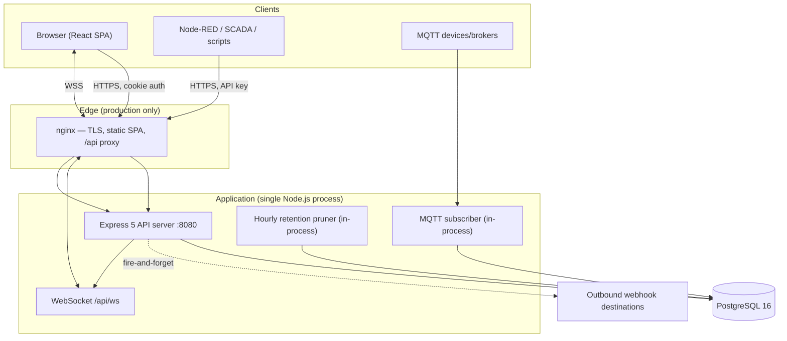
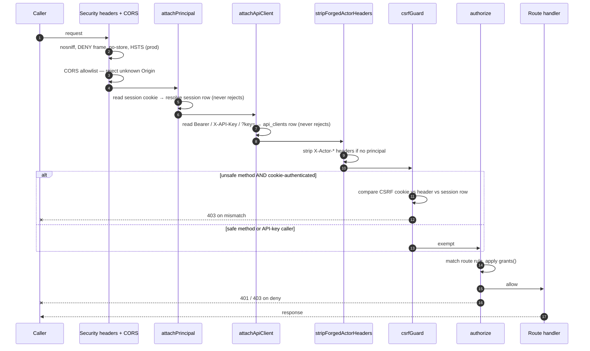
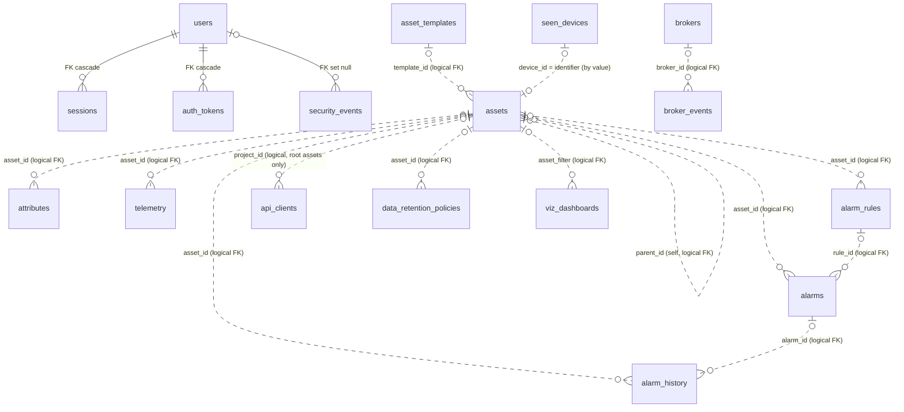

# Technical Specification Document

**System:** WS-Integrated Suite — Industrial IoT Data Acquisition & Analytics Platform
**Document type:** Technical Specification Document (TSD)
**Audience:** Engineers, technical reviewers, incoming maintainers
**Status:** Reflects the system as built and verified against the running codebase and live database. Known gaps are stated as gaps, not implied to be fixed.

---

## 1. Document Purpose & Scope

This document is a complete technical description of the WS-Integrated Suite platform: what it is, how it is built, how its pieces fit together, and what state it is currently in. It is written to be handed to a new engineer, a technical reviewer, or an auditor without requiring access to the commit history or prior conversations that produced the system.

It does **not** cover business requirements, roadmap, or pricing — see `docs/product-modernization-strategy.md` and `docs/review/requirements-traceability.md` for that material. Where this document and an older doc in `docs/` disagree, this document reflects the more recently verified state (see §11, Known Documentation Debt).

---

## 2. System Overview

WS-Integrated Suite ingests industrial sensor telemetry over HTTP (with MQTT and Azure IoT Hub as additional configured broker types), evaluates alarm rules against that telemetry in real time, and serves a configurable React dashboard for visualization, asset management, and alarm response.

**Core capabilities:**
- Multi-protocol telemetry ingestion (REST, MQTT, Azure IoT/Event Hub)
- A hierarchical asset model (sites → units → equipment → attributes)
- Real-time threshold, deviation, rate-of-change, and heartbeat alarm evaluation
- A drag-and-drop dashboard builder with a widget library
- Role-based access control enforced on both the API and the UI
- API-key-based machine access for gateways and integrators
- Outbound webhook delivery to third-party systems
- An AI copilot for natural-language questions about asset data

**Deployment model:** Self-hosted on a single Linux VM. There is no managed-platform dependency — the system was originally developed on a hosted preview environment (Replit) and has since been fully migrated off it; no Replit tooling, configuration, or dependency remains anywhere in the codebase.

---

## 3. Technology Stack

| Layer | Technology | Notes |
|---|---|---|
| Frontend | React 19 + Vite 7 | SPA, client-side routed |
| Routing | wouter | Lightweight router |
| Server state | TanStack Query v5 | Cache + mutation layer over generated hooks |
| UI components | shadcn/ui on Radix UI primitives | 55 primitives in `components/ui/` |
| Styling | Tailwind CSS v4 | Token-driven theme, light + dark |
| Charts | Recharts | Categorical palette validated for CVD accessibility |
| Backend framework | Express 5 | Async handlers typed `Promise<void>` |
| ORM | Drizzle ORM | Schema-first, `drizzle-kit push` (no migration files yet — see §11) |
| Database | PostgreSQL 16 | Single instance |
| API contract | OpenAPI 3.1 | `lib/api-spec/openapi.yaml`, source of truth for the API surface |
| Codegen | Orval | Generates TanStack Query hooks (`lib/api-client-react`) + Zod schemas (`lib/api-zod`) |
| Real-time transport | WebSocket, co-hosted on `/api/ws` | Single `broadcast()` fan-out, no pub/sub layer |
| Session auth | Opaque token + scrypt | Server-side session store, not JWT |
| Package manager | pnpm workspaces | `pnpm-workspace.yaml` catalog for shared versions |
| Build/bundle (API) | esbuild | `artifacts/api-server/build.mjs` |
| Process model | Single Node.js process per artifact | See §9 for why this cannot yet be scaled horizontally |

---

## 4. Repository Structure

```
Nexus-IoT/                          (pnpm workspace root)
├── artifacts/
│   ├── api-server/                 Express 5 REST + WebSocket API (port 8080, path /api)
│   ├── iot-platform/               React 19 + Vite SPA (path /)
│   └── mockup-sandbox/             Standalone UI prototyping sandbox (path /__mockup)
├── lib/
│   ├── api-spec/                   OpenAPI 3.1 spec + Orval codegen config
│   ├── api-client-react/           GENERATED — TanStack Query hooks + fetch client
│   ├── api-zod/                    GENERATED — Zod schemas (re-exports only)
│   └── db/                         Drizzle ORM schema (one file per table) + seed script
├── scripts/                        Preinstall check, cross-platform post-merge script, doc generators
├── docs/                           39 markdown files — architecture, data, API, security, ops, ADRs
├── attached_assets/                Sample Node-RED flow exports used for ingest testing
├── CLAUDE.md                       AI-agent working instructions for this repo
├── README.md                       Developer onboarding
└── docs/technical-reference.md     Detailed per-table / per-route reference (formerly `replit.md`)
```

**Dependency rule:** `artifacts/*` are leaf nodes and never import each other. The codegen chain flows one direction: `lib/db` → `lib/api-spec` → `lib/api-zod` + `lib/api-client-react`. The API server imports `lib/db` and `lib/api-zod`; the frontend imports `lib/api-client-react`. Editing an endpoint means editing `lib/api-spec/openapi.yaml` and running codegen — `src/generated/` files are never hand-edited.

**Root scripts** (`package.json`):

| Script | Command | Purpose |
|---|---|---|
| `dev:api` | `pnpm --filter @workspace/api-server run dev` | Start the API (build + run, no watch) |
| `dev:web` | `pnpm --filter @workspace/iot-platform run dev` | Start the Vite dev server |
| `start` | `node --enable-source-maps artifacts/api-server/dist/index.mjs` | Production start, bypasses pnpm for faster boot |
| `build` | typecheck then `pnpm -r --if-present run build` | Full build |
| `typecheck` | `tsc --build` for libs, then per-artifact `tsc --noEmit` | **Does not typecheck `artifacts/*` from the root filter reliably in all shells — verify each artifact directly if in doubt** |

---

## 5. Architecture

### 5.1 High-level component diagram



In local development, the Vite dev server plays the role nginx plays in production: it proxies `/api` (including the WebSocket upgrade) to `localhost:8080` so the SPA and API appear on one origin with no CORS handling needed.

### 5.2 Request lifecycle (API)

Every request under `/api` passes through five middleware in a fixed order, mounted once in `app.ts` so no individual route file can omit a guard:



**Authorization is enforced server-side.** `middleware/authorize.ts` is a ~370-line deny-by-default route table: every endpoint must have an explicit rule (permission + module + level), and an unmapped route returns `403` for a human caller with the denial logged to `security_events`. This corrects an earlier design decision (`docs/adr/ADR-004-rbac-frontend.md`) that is now historical — see §11.

### 5.3 Ingest pipeline

`POST /api/ingest/payload` (and its batch/validate/per-client variants) run through:

```mermaid
sequenceDiagram
  autonumber
  participant G as Gateway
  participant K as apiKeyAuth
  participant N as normalise()
  participant PR as processNormalised()
  participant DB as PostgreSQL
  participant WS as WebSocket clients
  participant W as Webhook destination

  G->>K: POST /api/ingest/k/:clientId/payload
  K->>DB: resolve api_clients by client_secret
  K->>K: status, expiry, IP allowlist, scope, rate limit checks
  K->>N: authenticated
  N->>N: deep-flatten payload to dotted tags, resolve timestamp
  N->>PR: { deviceId, timestamp, metrics }
  PR->>DB: SELECT assets WHERE identifier = deviceId
  alt no asset matches
    PR-->>G: 200 OK, recordsWritten: 0 (accepted, discarded — see §11)
  end
  PR->>DB: SELECT attributes for the matched asset(s)
  PR->>PR: partition metrics by declared attribute tag; undeclared tags dropped
  PR->>DB: INSERT telemetry rows
  PR->>DB: UPDATE dynamic attribute values
  PR->>PR: evaluate runtime expressions (expr-eval)
  PR->>DB: SELECT enabled alarm_rules, evaluate threshold/rate-of-change
  PR->>DB: INSERT/UPDATE alarms, alarm_history
  PR->>WS: broadcast telemetry + alarm events
  PR-->>W: fire-and-forget webhook POST, 5s timeout, errors swallowed
  PR-->>G: 200 OK { recordsWritten, alarmEvents }
```

Key behavioural rules:
- **Attribution is by exact, case-sensitive match** of the payload's `deviceId` against `assets.identifier`.
- **`assets.identifier` is deliberately non-unique** — one gateway payload can describe several plant sections, each modelled as its own asset sharing the same device id, partitioned by which attributes each asset declares.
- **Assets in maintenance mode suppress alarm evaluation** but still store telemetry.
- **No asset is auto-created.** An unmatched `deviceId` is recorded in `seen_devices` (for the asset-creation UI to offer) but the telemetry itself is discarded.
- **Undeclared metrics are silently dropped** — only `/api/ingest/validate` (a dry run that writes nothing) reports this; `/api/ingest/payload` does not.

### 5.4 Real-time (WebSocket)

One WebSocket endpoint (`/api/ws`), one `broadcast(type, data, options?)` function in `lib/ws-broadcast.ts`. Delivery is filtered per-connection by the caller's resolved permissions — a socket only receives event types its principal is allowed to see. There is no pub/sub layer or message queue; `broadcast()` iterates every open connection on the process synchronously. This is the reason horizontal scaling is not currently possible (see §9).

Server event types: `telemetry`, `alarm`, `broker_status`, `activity_log` and `security_event`. Nine reachable frontend surfaces consume them through a single `useWsEvents` hook (`hooks/useWsEvents.ts`): Live Feed, Live Twin, Visualization (through `features/dashboards/AssetVizPanel.tsx`), Active Alarms, Alarm History, Activity Log, Brokers, the notification bell and the broker status bar (both in `Layout.tsx`). Three more pages still call the hook but are not routed: `Dashboard.tsx`, `HomeOverview.tsx` (with `features/home/StatusRibbon.tsx`) and `AnalyticsKpi.tsx` (see §8.5); Home is now the project list and opens no socket of its own. The former alarm toast listener has been removed.

### 5.5 Deployment architecture (current)

The platform is self-hosted on a single Linux VM. Two things must be running:

1. **The API server** — built with `pnpm build`, started with `pnpm start` (or directly: `node --enable-source-maps artifacts/api-server/dist/index.mjs`), ideally under a systemd unit so it restarts on crash or reboot.
2. **A reverse proxy (nginx)** — because the API server intentionally has no static-file serving (`express.static` does not appear anywhere in `artifacts/api-server/src`). nginx serves the built SPA (`artifacts/iot-platform/dist/public`) with an `index.html` history fallback for client-side routing, terminates TLS, and forwards `/api` (including the `/api/ws` WebSocket upgrade) to port 8080.

Full step-by-step instructions, including the exact nginx config and a systemd unit template, are in **`docs/operations/vm-deployment-checklist.md`**.

**Critical operational constraint:** run exactly **one** instance of the API server. Rate-limit counters, alarm On/Off delay timers, the WebSocket connection registry, the in-process MQTT subscriber, and the hourly retention pruner are all held in that single process's memory. A second instance would double the effective rate limits, miss half of WebSocket broadcasts, and fight the first over the MQTT connection.

---

## 6. Data Model

### 6.1 Entity-relationship diagram



**Only three foreign keys are declared in the entire schema** (all → `users`, from the authentication subsystem: `sessions.user_id`, `auth_tokens.user_id`, `security_events.user_id`). Every other relationship shown above is enforced only in application code — a bare UUID column with no database-level constraint. This is a known, verified gap (see §11).

### 6.2 Table reference

**Identity & access**

| Table | Purpose | Notes |
|---|---|---|
| `users` | Accounts, role, per-user access overrides | scrypt password hash (OWASP params); `invited → active → suspended` lifecycle; lockout counters; `access_overrides` jsonb carries module R/W/D grants, project/dashboard/analytics restrictions, and grantable API-client scopes |
| `sessions` | Server-side session store | Opaque token, only its SHA-256 stored; idle TTL (30 min default) **and** absolute cap (12 h default); revocation reason recorded |
| `auth_tokens` | Activation / password-reset tokens | One table, `type` discriminator; SHA-256 only; single-use via `consumed_at` |
| `security_events` | Auth/security event stream, doubles as login history | `ON DELETE SET NULL` on `user_id` preserves the forensic trail after account deletion |
| `api_clients` | Machine credentials | `client_secret` stored **in plaintext** (known gap, §11); `scopes text[]` — an empty array is treated as *all scopes* by `apiKeyAuth`; `project_id` nullable and NOT a foreign key by design (a deleted project should orphan its client rather than cascade-delete a live credential) |

**Asset model**

| Table | Purpose | Notes |
|---|---|---|
| `assets` | The hierarchy; root rows (`parent_id IS NULL`) are "projects" | `identifier` (Device ID) is **deliberately non-unique**; `child_count`/`attribute_count` are maintained counters |
| `attributes` | Per-asset attribute definitions and latest values | Five types: `static\|dynamic\|metric\|runtime\|timestamp`; matched case-insensitively during ingest by `tagName` or `sourceMetric` |
| `asset_templates` | Reusable attribute sets | `attribute_definitions` is schemaless jsonb, so optional metadata needs no migration |
| `seen_devices` | Every deviceId ever received, matched or not | Feeds the Create Asset wizard; `POST /assets` refuses a Device ID this table hasn't seen |

**Time-series & alarms**

| Table | Purpose | Notes |
|---|---|---|
| `telemetry` | Every metric reading | Largest table by orders of magnitude (**3,386,688 rows** as of this document). Three btree indexes on `(asset, metric, ts)`, `(ts)`, `(asset, ts)`. `value` is `jsonb` even though values are overwhelmingly floats. Primary key is a random UUID (write-amplifying on an append-only table). **No partitioning.** |
| `alarm_rules` | Threshold / deviation / rate-of-change / heartbeat rules | `asset_id` nullable = applies platform-wide |
| `alarms` | Current alarm state | `active\|acknowledged\|cleared`; `asset_name` denormalised (goes stale on rename) |
| `alarm_history` | Closed alarm episodes | Append-only; also denormalises `asset_name`, which is correct here (historical record) |
| `data_retention_policies` | Pruning rules | Nullable `asset_id`/`metric` act as wildcards |

**Integration & operations**

| Table | Purpose | Notes |
|---|---|---|
| `brokers` | MQTT / REST / Azure IoT / Event Hub connections | `mqtt_password` stored in plaintext (known gap, §11). **Currently 0 rows** — all live ingest in this deployment goes through `api_clients`, not the broker table |
| `broker_events` | Connection state transitions | Unbounded — no retention policy covers it |
| `destinations` | Outbound webhook targets | Four credential columns (`token`, `secret_key`, `basic_pass`, plus header name), all plaintext |
| `viz_dashboards` | Saved dashboards | `widgets` jsonb |
| `activity_logs` | Business audit trail | Actor recorded by name/role/username from request headers, no FK to `users` — deliberate, so the trail survives user deletion, but see §11 for a caveat |

### 6.3 Known index gaps

Two hot-path queries run against unindexed columns:

- `assets.identifier` — queried on **every ingest payload** (`WHERE identifier = deviceId`), no index.
- `api_clients.client_secret` — queried on **every authenticated request**, no index (note `client_id` *is* uniquely indexed, but it is never the lookup key).

Fifteen of nineteen tables have no index beyond their primary key. Full ranked recommendations are in `docs/data/data-model.md` and the schema analysis performed during this system's review cycle.

---

## 7. Backend API

### 7.1 Surface size

126 route handlers across 22 route files (`routes/*.ts` other than `index.ts`), all mounted under `/api`. Counting the per-client ingest aliases (`/ingest/k/:clientId/…` and `/ingest/e/:token/…` for payload, batch and validate) separately, that is 132 method-and-path pairs, all of which are described in `lib/api-spec/openapi.yaml`. Full per-route documentation with request/response shapes is in `docs/api/api-reference.md` and `lib/api-spec/openapi.yaml` (the source of truth — the OpenAPI spec, not the route files, is what codegen reads).

### 7.2 Authentication modes

| Mode | Credential | CSRF | Used by |
|---|---|---|---|
| Session (human) | `is_session` cookie, opaque, SHA-256 stored | Required on state-changing requests | The SPA |
| API key (machine) | `X-API-Key` header or `Authorization: Bearer`. The `?key=` / `?apiKey=` / `?api_key=` query forms are ignored unless `API_KEY_ALLOW_QUERY_PARAM=true`. Per-client copy-and-paste URLs (`/ingest/e/:token/…`) carry their own token. Limit: `INGEST_RATE_LIMIT_RPM` (default 1200) requests per minute per client | Exempt (explicit header/query, not attachable cross-site) | Gateways, SCADA bridges, export integrations |
| None | — | — | Login, activation, password reset, health check, OpenAPI schema |

### 7.3 Endpoint groups

| Group | Representative routes | Auth |
|---|---|---|
| Public | `/auth/login`, `/auth/activate`, `/auth/session`, `/healthz`, `/export/schema` | None |
| Ingest | `/ingest/{payload,batch,validate,register-device}`, `/ingest/k/:clientId/*` | API key with `ingest:write` scope, or a human with the `brokers` module |
| Data read | `/export/{assets,telemetry,alarms,alarm-history}`, `/telemetry/:assetId/*`, `/dashboard/*` | `read:*` API scope or `explorer`/`dashboard` module |
| Assets/attributes/templates | `/assets`, `/assets/:id/*`, `/attributes/:id`, `/asset-templates` | `manage_assets` / `manage_templates` permission + `assets` module R/W/D |
| Alarms | `/alarms`, `/alarms/:id/acknowledge`, `/alarm-rules/*` | `acknowledge_alarms` / `manage_alarms` + `alarms` module |
| Brokers/destinations | `/brokers/*`, `/destinations/*` | `manage_brokers` / `manage_destinations` + `brokers` module |
| API clients | `/api-clients`, `/api-clients/:id/*` | `manage_api_clients` + `api_clients` module, plus a server-enforced scope ceiling (§7.5) |
| Visualization | `/viz-nodes`, `/viz-nodes/:id`, `/viz-nodes/:id/shares/*`, `/viz-nodes/import`, `/viz-tags`, `/uploads/*`; legacy `/viz-dashboards` (list only) | `visualization` module R/W/D; node ownership and shares checked in the route (`lib/viz-access.ts`) |
| Users/security | `/users/*`, `/security/*` | `manage_users` / `manage_security` |
| Reports/system | `/activity-log`, `/system/*` | `activity_log` / `reports` module |
| AI | `/ai/chat` | `explorer` module |

### 7.4 Error contract

| Status | `code` examples | Meaning |
|---|---|---|
| 400 | `scopes_required`, `invalid_project` | Body rejected — Zod message or a named cause |
| 401 | `authentication_required`, `session_expired`, `session_revoked` | Machine routes include a `hint` naming the required header and scope |
| 403 | `insufficient_permission`, `no_authorization_rule`, `csrf_failed`, `scope_forbidden` | Includes `required: { permission, module, level }` |
| 413 | — | Request body over the 1 MB limit |
| 429 | — | Rate limited; `Retry-After: 60` header set |
| 500 | `internal_error` | Message text suppressed in production |

### 7.5 RBAC model

Two independent axes:

1. **What a signed-in human can do** — `permissions` (verbs like `manage_assets`) combined with a per-module R/W/D matrix (`modules.assets.write`, etc.). An administrator's explicit per-user override always wins over the role default; without an override, both the role's permission list and its module default must allow the action.
2. **What a credential a user *creates* is allowed to do** — a separate scope ceiling (`ROLE_API_SCOPE_DEFAULTS`, per-user overridable). By default, `engineer` may only grant `ingest:write` on a credential they create; only `admin`, `company_admin` and `super_admin` may grant read scopes or the `*` super-scope. This is enforced at the `POST /api-clients` route itself, not only hidden in the UI — a direct API call from an engineer account requesting `read:telemetry` returns `403 scope_forbidden`.

The full route-rule table lives in `middleware/authorize.ts`; the scope-ceiling logic lives in `lib/rbac.ts` (`ROLE_API_SCOPE_DEFAULTS`, `ungrantableScopes`, `canCreateApiClients`).

---

## 8. Frontend

### 8.1 Screen inventory

33 routed screens across 8 navigation groups (Home, Asset Management, Data Explorer, AI Assistant, Alarm Management, Broker Management, Admin Center, System), plus public/auth screens (Login, Activate, Reset Password) outside the authenticated shell. Full per-screen line counts and module gates are catalogued in the frontend review performed during this system's review cycle.

### 8.2 Data fetching

Two paths, both wrapped in TanStack Query:

- **Generated hooks** (`useListAssets`, `useCreateApiClient`, etc.) from `lib/api-client-react`, for anything defined in the OpenAPI spec.
- **Hand-rolled `apiGet`/`apiFetch`** (`lib/auth-api.ts`) for the handful of routes not yet in the spec.

### 8.3 Authorization in the UI

`UserContext` exposes `can()`, `canModule()`, `canAction()`, `canDashboard()`, `canProject()`, `canAnalytics()` — all driven by the same catalogue the API serves at `GET /security/rbac-catalog`, so the frontend cannot promise access the server will refuse. `RouteGuard` handles the session/password-change interstitial; `Protected` gates each route by module; `RoleGuard`/`ReadOnlyBanner` gate individual controls within a page.

### 8.4 Feature flags

`lib/features.ts` is a single object (`FEATURES`) gating both the router entry and the nav entry for a feature together, so a disabled feature is unreachable by direct URL, not merely hidden. Currently one flag: `payloadSimulator` (off by default, overridable at build time via `VITE_ENABLE_PAYLOAD_SIMULATOR=true`).

### 8.5 Known frontend debt

- `pages/AnalyticsKpi.tsx` (2,770 lines, the largest file in the frontend) and `pages/DataExplorer.tsx` (324 lines) have no route, no nav entry, and no importer — they do not run. Three files in `features/dashboards/` cite `AnalyticsKpi.tsx` in comments as the time-range/aggregation behaviour they mirror, meaning the "reference implementation" for that logic is unreachable code.
- No React error boundary existed prior to this review cycle; one now wraps the app root (`components/ErrorBoundary.tsx`), replacing the dev-time error overlay that was removed along with the platform's original hosted-preview tooling.

### 8.6 Theming

Light and dark themes are both explicitly designed (not one inverted from the other) as HSL custom properties in `index.css`, mapped through Tailwind's `@theme inline`. The categorical chart palette (`lib/chartColors.ts`) is validated against both surfaces for colour-vision-deficiency separation (worst adjacent pair ΔE ≥ 12.6 under deuteranopia) and contrast, and is split into `SERIES` (identity) and `STATUS` (state) so an ordinary data series is never accidentally painted in an alarm colour.

---

## 9. Operational Constraints

The platform is **single-instance by construction**. The following state lives only in the one running process's memory, with no shared backing store:

| State | Where | Consequence of a second instance |
|---|---|---|
| Per-client rate-limit counters | `middleware/apiKeyAuth.ts` | Effective rate limit multiplies by instance count |
| Sign-in, API and flood rate-limit counters | `lib/rate-limit-store.ts`, `middleware/rateLimit.ts`, `middleware/apiRateLimit.ts` | Effective limits multiply by instance count |
| Alarm On/Off delay timers | `routes/ingest.ts` (`pendingOn`, `pendingOff`) | Each instance times delays from only the messages it sees |
| WebSocket connection registry | `lib/ws-broadcast.ts` | Each instance only reaches its own sockets — some clients silently miss events |
| MQTT subscriber | `services/mqtt.ts` | Every instance connects with the same stable client id, so the broker keeps disconnecting one in favour of the other (reconnect loop, gaps in ingest) |
| Hourly retention pruner | `src/index.ts` | Concurrent pruners running against the same tables |

A restart resets the counters and restarts running alarm delays (an alarm can fire up to one delay period late); see `docs/technical-reference.md`, "Process-local state", for the full list and restart effects. Horizontal scaling requires moving this state onto shared infrastructure (Redis for counters and pub/sub, an MQTT shared subscription or leader election, an advisory-lock-based pruner leader) — none of which is currently implemented.

---

## 10. Security Posture

### 10.1 Solid

- Session tokens and password-reset/activation tokens are stored only as SHA-256 hashes; the raw value exists exactly once, in the cookie or the emailed link.
- Passwords use scrypt at OWASP-recommended parameters with `timingSafeEqual` comparison; login is timing-equalised against unknown usernames (a failed lookup still runs a full scrypt derivation before responding).
- CSRF protection is session-bound, not just double-submit cookie — it checks the token against the session row as well as the cookie, closing the subdomain-cookie-write attack that plain double-submit is vulnerable to.
- Route authorization is deny-by-default and centrally enforced (§5.2) — an added route with no rule fails closed for human callers, loudly, in development.
- Temporary (admin-issued) passwords restrict the session to four endpoints until changed, so a credential shared over chat or a ticket cannot be used for anything else.
- Structured logs redact `Authorization`, `Cookie`, and `X-API-Key` headers, and strip query strings from logged URLs.

### 10.2 Open findings (verified, not yet remediated)

| # | Finding | Evidence |
|---|---|---|
| 1 | `api_clients.client_secret`, `brokers.mqtt_password`, and all four `destinations` credential columns are stored in plaintext | Direct schema inspection |
| 2 | An API key satisfies authorization for a route with **no matching rule** — `middleware/authorize.ts:248`, `rule === undefined` is treated as permission for a machine caller | Verified against current source; not corrected |
| 3 | `AUTH_SESSION_REQUIRED=false` opens every `GET` endpoint to unauthenticated callers, and is **not** in the fatal-configuration checklist that `assertAuthConfigSane()` runs before production boot (unlike `AUTH_ENFORCE=false`, which is) | Verified against current source; not corrected |
| 4 | `api_clients.scopes` defaults to an empty array, and an empty array is treated by `apiKeyAuth` as *all scopes* | Schema default + `apiKeyAuth.ts` logic |
| 5 | Device resolution during ingest has no tenant predicate — any `ingest:write` key can write telemetry into any asset by naming its `deviceId` | `routes/ingest.ts`, confirmed no `project_id` filter |
| 6 | `activity_logs` records the actor from client-supplied `X-Actor-*` headers for any *authenticated* request (anonymous forgery is blocked, authenticated forgery is not) | `routes/activity_log.ts` |
| 7 | A live example of finding 5's consequence exists in the current database: the one `api_clients` row's `project_id` (`467d038b-…`) does not match any existing asset id — a dangling reference that a tenant-scoped resolution would need resolved before enforcement could be turned on | Verified by direct query, this document's preparation |

None of the above are hypothetical; each was confirmed by reading the current source or querying the live database at the time this document was written.

---

## 11. Known Documentation Debt

- `docs/adr/ADR-004-rbac-frontend.md` states that "API endpoints are effectively open to anyone with network access" and recommends adopting an external identity provider. This is **no longer accurate** — server-side authorization was subsequently built (§5.2, §7.5) using session auth plus a deny-by-default route table, not an external IdP. The ADR has not been marked superseded; treat its "Decision" and "Future State" sections as historical only.
- `docs/adr/ADR-007-cross-platform-compatibility.md` and four files under `docs/operations/` and `docs/architecture/` (`08-deployment-architecture.md`, `infrastructure.md`, `runbook.md`, `devops.md`) still describe the platform's original hosted-preview deployment model in detail (topology diagrams, workflow definitions, secrets management). These were deliberately left as a deferred rewrite when the platform was migrated to self-hosted VM deployment — `docs/operations/vm-deployment-checklist.md` is the accurate, current deployment reference.
- `docs/DOCUMENTATION_STATUS.md` still lists several "Confidence: High" assumptions tied to the old hosted-preview model that are now false (e.g., managed database encryption, proxy-level mTLS).

---

## 12. Glossary

| Term | Meaning |
|---|---|
| Project | A root-level asset (`assets.parent_id IS NULL`) — the unit an API credential is scoped to and the unit a user's access can be restricted to |
| Device ID | The value in `assets.identifier`; matched exactly and case-sensitively against a payload's `deviceId` during ingest |
| Attribute | A named, typed value on an asset — static, dynamic, metric, runtime, or timestamp — the unit that ingest maps payload metrics onto |
| Scope (API) | A capability string on an `api_clients` row (`ingest:write`, `read:assets`, …, or `*`) |
| Module | A UI/API permission domain (`assets`, `alarms`, `brokers`, …) with independent read/write/delete grants |
| Principal | The resolved identity (human session or machine API key) attached to a request by `attachPrincipal`/`attachApiClient` |

---

*This document was produced by directly reading the current source tree and querying the live database rather than from memory of prior discussion. Where a fact could not be verified at the time of writing, it is stated as unverified rather than assumed.*
